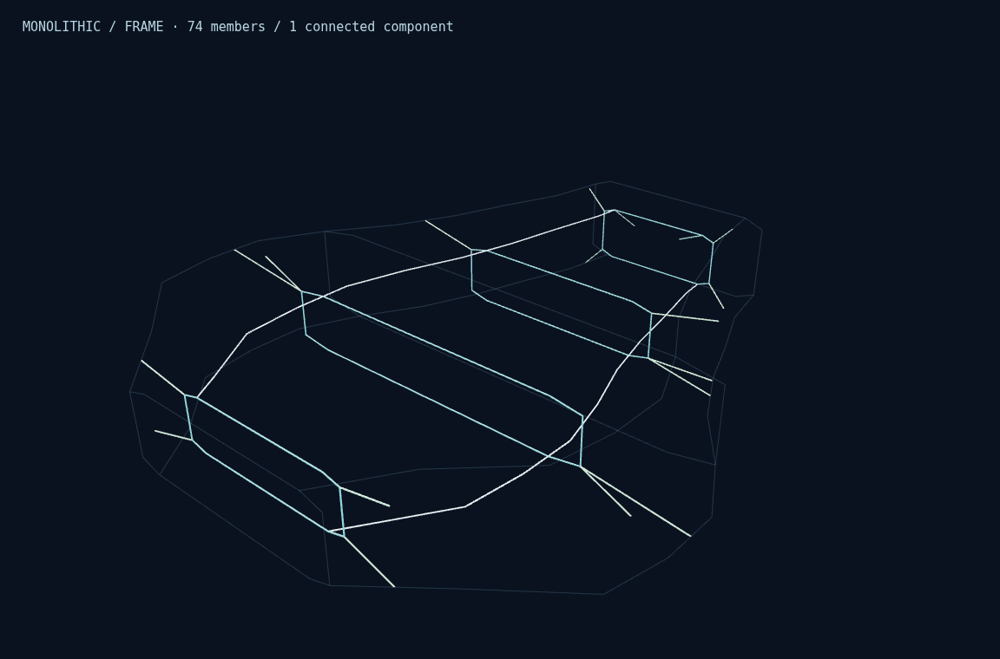
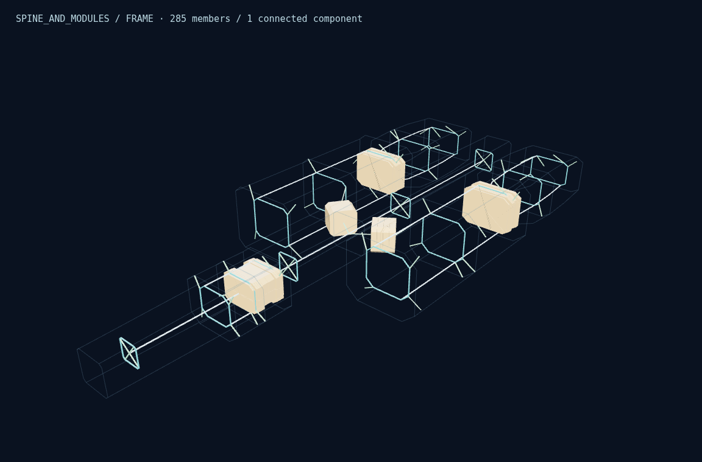
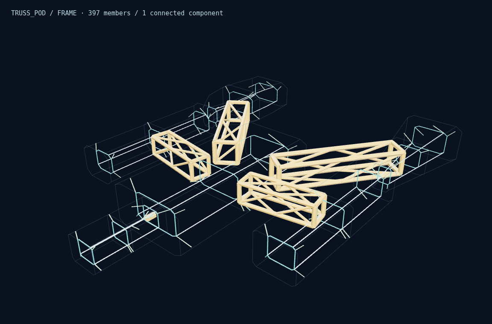
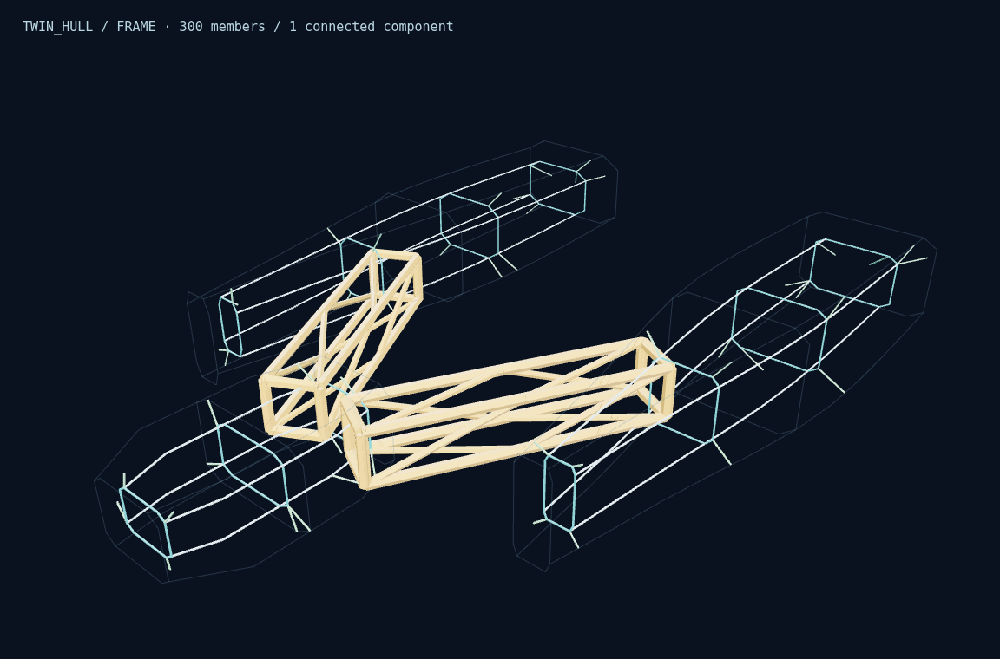
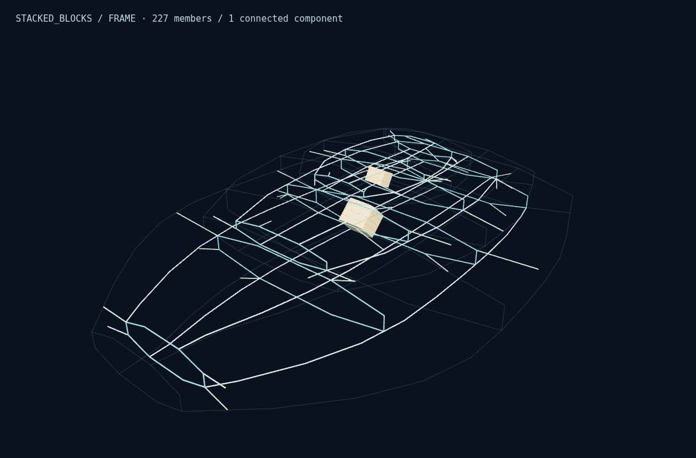
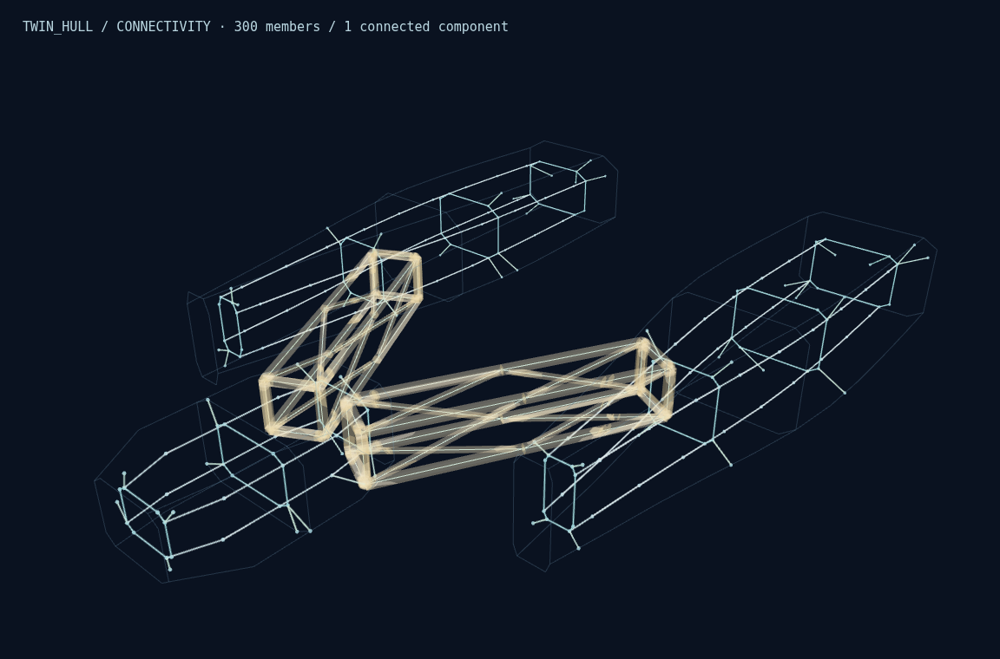
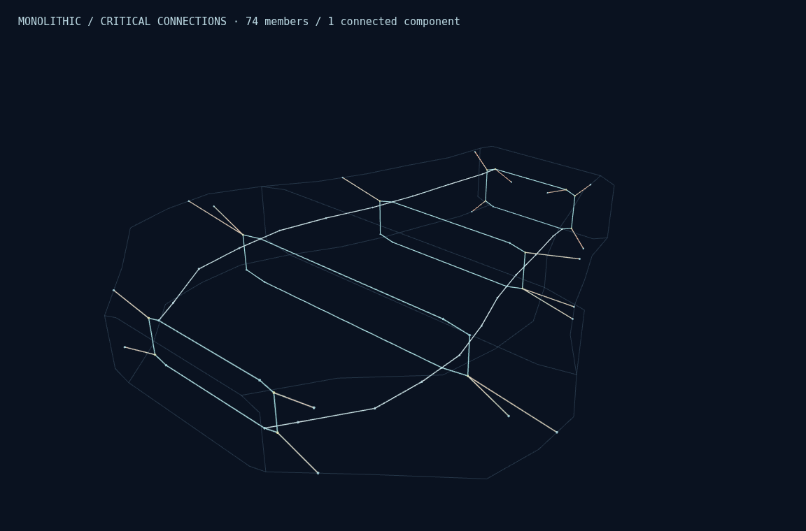
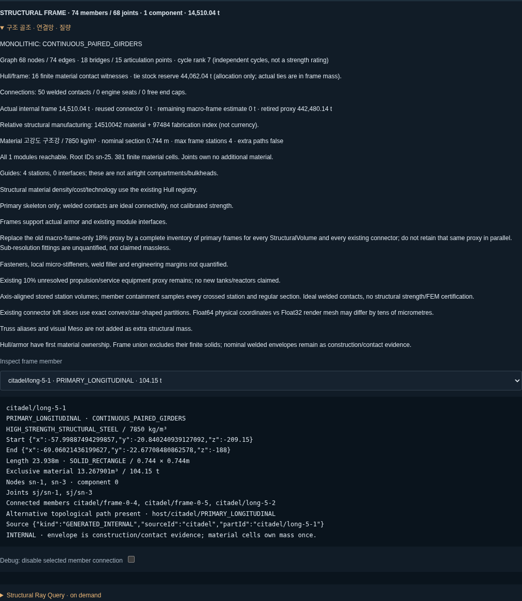

# V1.8.6.1 — Structural Frame & Connectivity QA

기준: `795b1ff59a29c4c1c0c69048243452ea57c7cbbf` (`feature/v1.8.6.0.2`). 작업: `feature/v1.8.6.1`, `/workspace/shipyard-v1.8.6.1`. 원본 `work` HEAD는 `4186add48573ef9eb4452dbf0dce408d677cef08`로 별도 보존했다. 이전 worktree와 미커밋/QA 자료를 덮어쓰지 않았다. combat-demo 변경, 원격 Push, Force Push는 없다. 최종 로컬 Commit SHA는 완료 응답과 이 브랜치의 `git log -1`에서 확인할 수 있다.

## 구현 및 데이터 계약

신규 Procurement 생성의 기본 경로에 실제 골조를 추가했다. `generateProcurementBlueprint(order, {version:'1.8.6.0.2'})`는 이전 생성 계약을 재현하며, 일반 Blueprint Load는 새 골조를 삽입하지 않는다. 최상위 schemaVersion 2는 유지하고 선택적 `structuralFrame`(schemaVersion 1, version 1.8.6.1)을 추가했다. 내부 생성 규칙/캐시 서명 revision은 2다.

종통재, 횡프레임, 보강재, 트러스, 기존 Connector, 엔진 지지대, 실제 Hull Shell까지 연결하는 지지 부재를 구현했다. 부재는 연결점·단면·재질·밀도·유한 형상·실제 체적·질량·노드/접합부 참조를 가진다. `lengthM`은 연결점 사이의 span이며, 기존 loft stock의 전체 연장부와 collar는 `envelope`/`bounds`에 명시된다. 질량은 span × 표시 단면으로 추정하지 않고 최종 저장된 닫힌 물리 체적으로 계산한다.

기존 Connector의 renderer와 물리 구조가 하나의 parametric recipe를 공유한다. 실제 rail/bay/brace/neck/collar를 재사용하고 `trusses` 별칭이나 시각용 Meso를 새 구조 질량으로 더하지 않는다. 내부 접속은 실제 stock을 절단하여 그래프 span도 같은 위치에서 나눈다. stock 측면 접촉은 실제 유한 교집합으로 확인한다.

Hull 지지점은 실제 생성된 HULL 물리 셀에서 선택한다. 선체 내부 cage에서 그 셀까지 실제 부재를 만들고 Hull 유한 경계로 절단한다. 기존 stock이 이미 경로를 제공하면 실제 접촉을 기록하고 가상/중복 부재를 만들지 않는다. Hull이 없는 개구부나 미지정 SPINE에 가짜 외피를 만들지 않는다. `skinAttachments`는 surface/piece/member ID, 실제 위치, 양의 유한 교집합 witness를 저장한다. 지지 stock의 보수적 체적 예약은 스킨 생성 전에 질량 배분에 포함하며, 예약 자체는 설치 질량에 합산하지 않는다.

`hostIds`/`VOLUME_CONTEXT`는 소속 정보다. 실제 물리 접촉은 별도의 finite weld 증거와 PHYSICAL_SKIN/ENGINE/CONNECTOR 참조로 구분한다. 접합부는 WELDED_CONTACT, ENGINE_MOUNT_INTERFACE, SKIN_ATTACHMENT, CAPPED_MEMBER_END로 구별한다. 접합 재료는 부재 union 또는 기존 스킨이 소유하므로 별도 질량을 추가하지 않는다.

## 8종 Architecture 실험

각 표본은 실제 Native Order와 Blueprint로 보관했다. 역할·크기·조선소를 모두 동일하게 한 Architecture 전수 실험은 수행하지 않았다. 각 Architecture 대표 1척씩과 별도의 통제 우선순위 표본만 사용했다.

| Architecture | 조선소 / 함종 / m / Seed | 실제 문법 | 부재 | N / E | 접촉 witness | Bridge / Cut | Cycle rank |
| --- | --- | --- | --- | --- | --- | --- | --- |
| MONOLITHIC | aegis / Battleship / 470 / 7 | CONTINUOUS_PAIRED_GIRDERS | 74 | 68 / 74 | 16 | 18 / 15 | 7 |
| BLOCK_ASSEMBLY | forge / Battleship / 500 / 7 | BLOCK_BOUNDARY_CAGE | 274 | 230 / 274 | 60 | 74 / 69 | 45 |
| SPINE_AND_MODULES | vesper / Cruiser / 300 / 12 | AXIAL_SPINE_WITH_MODULE_INTERFACES LOCAL_MODULE_CAGE | 285 | 245 / 285 | 60 | 77 / 75 | 41 |
| TRUSS_POD | vesper / Frigate / 300 / 7 | POD_CAGE | 397 | 304 / 397 | 72 | 85 / 88 | 94 |
| TWIN_HULL | forge / Frigate / 400 / 11 | TWIN_BOX_GIRDERS | 300 | 240 / 300 | 44 | 52 / 47 | 61 |
| CORE_AND_NACELLES | vesper / Frigate / 200 / 11 | RADIAL_CORE_HUB NACELLE_CAGE | 257 | 226 / 257 | 60 | 93 / 82 | 32 |
| STACKED_BLOCKS | aegis / Cruiser / 300 / 7 | STACKED_LOAD_TRANSFER_CAGE | 227 | 193 / 227 | 44 | 51 / 46 | 35 |
| HYBRID | serein / Frigate / 300 / 11 | AXIAL_SPINE_WITH_MODULE_INTERFACES POD_CAGE NACELLE_CAGE HYBRID_HULL_CAGE | 345 | 275 / 345 | 60 | 81 / 74 | 71 |

MONOLITHIC은 연속한 두 종통재, BLOCK_ASSEMBLY는 블록별 4개 주 경로와 실제 경계 연결, SPINE_AND_MODULES는 주축과 모듈별 cage, TRUSS_POD는 포드별 3개 경로와 기존 lattice, TWIN_HULL은 좌우 box girder와 실제 횡연결, CORE_AND_NACELLES는 방사형 중심 지지와 nacelle cage, STACKED_BLOCKS는 적층 부재와 실제 수직 접합, HYBRID는 실제 SPINE/POD/NACELLE/HULL 구성에 따른 혼합 문법을 사용한다. 모든 표본의 최종 Frame graph는 1 component이며 주요 모듈의 미도달 사례는 0이다.

## Connectivity 및 실제 접합

무방향 다중 그래프에 Tarjan 분석을 적용했다. parent node가 아니라 parent edge를 구별하여 실제 병렬 부재를 올바르게 처리한다. Connected components, module reachability, bridge, articulation point, cycle rank를 저장한다. ROOT는 MONOLITHIC의 연속 구조와 TRUSS/TWIN의 분산 구조에서 다르게 선택한다.

각 edge는 양의 실제 재료 체적을 가진 부재를 참조한다. 실제 접합 증거는 유한 체적 중첩 또는 유한 공통 면이다. 동일 좌표 이름만으로 weld를 승인하지 않는다. Hull 지지는 실제 HULL 셀과 연결된 부재/stock을 따로 추적한다. 표시용 stock/envelope와 재료 소유권을 한 번만 계산하는 `pieces`를 구분한다.

Cycle rank는 독립 순환 경로 수이며 전체 모듈 간 edge-disjoint 경로 수나 공학적 강도가 아니다. Frame graph는 의도한 부재/접합의 하중 경로 모델로, Hull/Armor 연속체 전체의 응력 해석을 대체하지 않는다. 기존 외부 neck가 하나인 곳에서 ENDURANCE가 두 번째 외부 Connector를 발명하지 않으며 제한 사유를 기록한다.

## 470m 우선순위 통제 비교

AEGIS / Battleship / MONOLITHIC / Seed 7 / 470m / 목표 3,562,847t / 최대 기본 질량 5,000,000t를 고정했다. Primary만 변경하고 나머지 값은 기존 Native 기본값을 사용했다. 구조 재질은 공식 Hull registry 3종을 재사용한다.

| 정책 | 부재 | 구조 부피 m³ | 실제 내부 골조 t | 재질 | 접합부 / N / E | Bridge / Cut / Cycle | 기본 질량 t | 구조 제조 index |
| --- | --- | --- | --- | --- | --- | --- | --- | --- |
| ARMOR | 88 | 5,094.86 | 39,994.64 | HIGH_STRENGTH_STRUCTURAL_STEEL | 78 / 78 / 88 | 22 / 18 / 11 | 1,306,010.22 | 40,170,511 |
| MOBILITY | 60 | 937.15 | 2,624.03 | LIGHT_STRUCTURAL_ALLOY | 56 / 56 / 60 | 16 / 14 / 5 | 506,141.95 | 3,214,881 |
| ENDURANCE | 148 | 3,890.53 | 17,507.39 | TITANIUM_STRUCTURAL_ALLOY | 94 / 94 / 148 | 0 / 0 / 55 | 621,807.91 | 52,756,318 |
| ECONOMY | 58 | 1,259.41 | 3,526.36 | LIGHT_STRUCTURAL_ALLOY | 54 / 54 / 58 | 14 / 12 / 5 | 740,991.16 | 4,304,791 |
| BALANCED | 74 | 1,848.41 | 14,510.04 | HIGH_STRENGTH_STRUCTURAL_STEEL | 68 / 68 / 74 | 18 / 15 / 7 | 613,929.85 | 14,607,526 |

ARMOR는 실제 방호 구역의 보강, 부재 단면 및 frame station 투자를 늘린다. MOBILITY는 낮은 밀도와 단면/불필요한 보강 축소로 실제 구조 질량을 줄인다. ENDURANCE는 추가 종통재·대각재·독립 엔진/Hull 지지 경로로 실제 순환 경로를 늘린다. ECONOMY는 기술 한도 내 밀도 × 단위 질량 비용으로 단위 부피 비용을 비교하고, 규격/접합/부재 수를 줄인다. 경합은 실제 구조 예약과 기존 스킨·추진·운용·장비 배분에 연결된다. 추진 성능이나 내구 성능을 계산한 것처럼 표시하지 않는다.

제조 비용은 재료 질량 × registry 비용 지수와 실제 member span × (width+height) × (12+4×tech), 접합/단부 수 × 200, 단면 종류 수 × 2,000 등의 상대 공정 지수다. 기존 Connector 개수 기반 surcharge는 실제 구조 공정 계산으로 교체했다. 미생성 내부 설비/게임 화폐/시장 가격/응력 강도는 포함하지 않는다.

## 질량 회계와 방호 보존

Frame Mass = 최종 닫힌 배타적 재료 체적 × 구조 재질 밀도. 프레임 간 중첩을 union 소유권으로 한 번만 계산하고, 기존 Armor/Hull 스킨의 실제 셀을 제외한다. 단위는 m, m³, kg/m³, kg이며 표시만 t로 변환한다. 독립적인 원점 기준 signed tetrahedron 체적과 생성기의 근방 원점 기준 체적을 교차 검산했다.

기존 18%는 부재/재질 BOM이 없던 legacy frame proxy였다. 이를 새 primary-frame 인벤토리(모든 StructuralVolume 및 실제 Connector)의 명시적 모델로 교체하고 `retiredLegacyFrameProxyKg`로 기록했다. 그 전체 값을 Actual Frame에 다시 더하지 않는다. **remainingStructuralEstimateKg=0은 이 primary macro-frame 교체 범위만 뜻한다. 미생성 미세 보강재·fastener·weld filler·공학 여유를 질량 0으로 확정한 것이 아니며, 해당 질량은 미산정이다.** 구 proxy와 개별 물량의 정밀 대응 검증은 원래 명세가 없어 불가능하다. 새 총질량 역시 완성 CAD/BOM 또는 인증된 실제 질량이 아니다.

Hull Shell, Armor, Actual Frame, Existing Connector, 남은 추정 구조, Core Equipment, Mounted Equipment, Platform, Other Estimated를 분리한다. 기존 10% propulsion/service proxy와 core geometry × 160kg/m³ 추정은 추정으로 남긴다. 세부 장비 재료/미세 구조까지의 완전한 재료 배타성은 아직 증명하지 않는다. 기본 질량과 장비 추가 이후 질량은 분리되며, 외부 장비 설치에 내부 공간/전력/급탄/응력 또는 기본 발주 상한을 새 gate로 적용하지 않는다.

| 표본 | 기존 기본 질량 t | 새 기본 질량 t | 실제 Frame / Connector t | 동일 Skin 데이터 | 상태 |
| --- | --- | --- | --- | --- | --- |
| BALANCED | 1,041,899.95 | 613,929.85 | 14,510.04 / 0.00 | True | PASS |
| BLOCK_ASSEMBLY | 1,047,351.34 | 998,141.73 | 36,615.16 / 248,167.39 | True | PASS |
| SPINE_AND_MODULES | 70,195.31 | 246,172.24 | 5,242.51 / 197,279.92 | True | PASS |
| TRUSS_POD | 104,025.41 | 238,999.62 | 6,677.24 / 162,610.90 | True | PASS |
| TWIN_HULL | 361,202.23 | 538,318.29 | 14,056.32 / 255,377.23 | True | PASS |
| CORE_AND_NACELLES | 24,905.47 | 342,004.66 | 1,336.99 / 322,197.56 | True | COMPROMISE |
| STACKED_BLOCKS | 255,249.84 | 213,620.88 | 8,633.34 / 51,935.22 | True | PASS |
| HYBRID | 86,755.63 | 281,459.62 | 5,713.75 / 215,710.34 | True | PASS |

470m BALANCED의 최종 기본 질량 명세(장비 미장착):

| 항목 | 질량 t | 출처 |
| --- | --- | --- |
| HULL_SHELL | 59,017.37 | GEOMETRY_DERIVED |
| ARMOR | 293,041.27 | GEOMETRY_DERIVED |
| STRUCTURAL_FRAME | 14,510.04 | GEOMETRY_DERIVED |
| STRUCTURAL_CONNECTOR | 0.00 | GEOMETRY_DERIVED |
| STRUCTURE | 0.00 | LEGACY_ESTIMATE |
| CORE_EQUIPMENT | 1,538.87 | ESTIMATED |
| MOUNTED_EQUIPMENT | 0.00 | ESTIMATED |
| PLATFORM | 0.00 | ESTIMATED |
| OTHER_ESTIMATED | 245,822.30 | LEGACY_ESTIMATE |

합계 613,929.85t. 목표 3,562,847t, 최대 5,000,000t. 목표를 합계에 복사하지 않았으며 미산정 미세 부품은 이 합계의 불확실성으로 남는다.

기존 loft neck/collar는 폐쇄된 **solid 구조 stock**으로 정의했다. hollow box girder의 벽 두께가 과거 데이터에 없으므로 이를 숨겨 가정하거나 목표 질량에 맞춰 밀도를 줄이지 않았다. 특히 CORE 표본은 큰 stock의 실제 질량이 구 proxy보다 커서 soft target을 놓치며 COMPROMISE다. 이는 형상/재질 모델 선택에 따른 큰 비용으로 공개하며, 모든 모델이 가볍거나 공학적으로 최적이라고 주장하지 않는다. 향후 hollow section을 도입한다면 명시적인 새 설계/버전이 필요하다.

구조 예약이 늘어 기존 장갑이 얇아지는 중간 실험은 폐기했다. 최종 모델은 이전 물리 스킨 allowance를 유지하고 필요한 경우 선택적 예약을 재배분한다. 실제 필수 예약이 목표를 넘으면 soft target/계획 예약의 차이를 기록한다. 최대 기본 질량을 지키며 기존 방호 allowance를 유지할 수 없으면 명시적으로 거절한다. 보수적인 사전 체적/면적 상계 때문에 아주 좁은 cap에서 최적 해를 모두 탐색하는 solver는 아니다. 최종 상한 판정은 현재의 계산/추정 기본 질량에 대해 수행하며 미산정 부품까지 인증하지 않는다.

8개 대표 입력에서 Hull/Armor Geometry뿐 아니라 기존 물리 스킨 전체가 byte-equivalent JSON hash로 일치했다. 동일 외부 probe 3개씩도 이전 결과와 일치한다. Snapshot Load는 과거 물리 데이터를 다시 쓰지 않는다.

## 물리 조회와 미래 데이터

`structuralMember`, `prepareStructuralQueries`, `structuralRayProbe`를 제공한다. 실제 배타적 convex cell의 plane/BVH 기반 진입·이탈, 위치, 법선, 경로 길이, material/member/node/edge 참조를 반환한다. 점 쿼리는 실제 셀 포함을 확인하고 반경 쿼리는 후보를 반환한다. 전체 triangle mesh 생성 없이 조회하며, accelerator와 snapshot은 요청 시 준비하고 재사용한다. 쿼리 snapshot은 설계 변경 이후에도 이전 상태를 유지한다. 선박 rigid Quaternion 회전과 평행이동을 검증했다.

외부 Armor Ray Probe는 독립적으로 유지했다. 새 테스트는 실제 접촉점의 ray가 Hull에서 Frame으로 이어지는지도 검증한다. 노출된 트러스는 Hull 없이 직접 Frame에 맞을 수 있으므로 미래 runtime은 두 조회 계층을 실제 거리로 병합해야 한다. 이번 버전은 관통/탄종 피해 계산을 하지 않는다.

StructuralInstanceState는 비활성 member/joint/edge ID를 따로 보관한다. Debug edge 제거로 구조 집합을 재분석하되 설계와 다른 instance를 변경하지 않는다. 실제 절단·포드 분리·HP·응력/파괴 강도는 구현하지 않았다. 미래 격벽에는 volume 경계 참조, 실제 frame station, module interface 및 Hull Shell ID를 제공한다. frame은 기밀 bulkhead가 아니다.

SPINE 내부 골조의 재질/체적/연결은 정의했다. 그러나 과거 SPINE 외부 렌더 경계의 shell 재질/두께는 여전히 미정이다. 기존 외부 probe는 해당 경계를 PARTIAL/UNRESOLVED로 보고하며 가짜 Hull/Armor로 채우지 않는다. 이 미산정 외피 질량은 완전한 건조 질량/상한 인증의 한계다.

## 성능

Fresh Node v24 process per cold sample; same 470m AEGIS/Battleship/Monolithic/seed7/target3,562,847t/maximum5,000,000t. Opt-in profiling enabled on both. Each cold sample followed by one same-process cache-hit generation. Module import measured separately. Three samples: p95 is the maximum, not a robust tail estimate. Additional architectures n=1; after data in ../after. No browser or test runner concurrent.

| 상태 | 최초 중앙값 / p95 s | 반복 중앙값 / p95 s | module import ms | 최대 프로세스 RSS MiB |
| --- | --- | --- | --- | --- |
| before | 4.525 / 4.647 | 1.708 / 1.819 | 21.03 | 589.1 |
| after | 4.835 / 5.024 | 1.897 / 1.932 | 24.40 | 674.9 |

| 대표 구조 (추가 n=1) | 기존 최초 / 반복 s | 새 최초 / 반복 s | raw 구조 생성 ms | 통합/접촉 ms | raw + integrated cache 추정 MiB |
| --- | --- | --- | --- | --- | --- |
| SPINE_AND_MODULES | 6.845 / 2.339 | 8.648 / 3.088 | 395.8 | 1078.1 | 77.9 |
| CORE_AND_NACELLES | 11.326 / 3.437 | 18.103 / 4.603 | 422.9 | 3872.7 | 128.9 |
| TRUSS_POD | 11.436 / 6.064 | 13.799 / 7.067 | 529.7 | 1441.5 | 105.9 |

470m 첫 번째 최종 cold sample의 단계별 시간(전체 중앙값과 별도, nested 단계는 중복 합산하지 않음):

| 단계 | ms | 호출 |
| --- | --- | --- |
| Structural generation | 69.181 | 1 |
| Structural joints | 7.672 | 1 |
| Structural graph construction | 0.604 | 1 |
| Structural material union | 34.152 | 1 |
| Procurement physical build | 2395.547 | 1 |
| Hull skin support ties | 96.537 | 1 |
| Hull support graph and joints | 5.726 | 1 |
| Final structural connectivity | 0.423 | 1 |
| Structural skin integration | 318.617 | 1 |
| Procurement final validation | 703.492 | 1 |

| 표본 | 부재 / N / E | 재료 셀 / triangles | 선택적 query 준비+첫 probe ms | query plane 저장 추정 KiB | raw + integrated cache 추정 MiB |
| --- | --- | --- | --- | --- | --- |
| BALANCED | 74 / 68 / 74 | 381 / 6398 | 33.98 | 96.5 | 32.5 |
| SPINE_AND_MODULES | 285 / 245 / 285 | 2827 / 45112 | 168.74 | 710.3 | 77.9 |
| CORE_AND_NACELLES | 257 / 226 / 257 | 7466 / 101893 | 574.60 | 1847.2 | 128.9 |
| TRUSS_POD | 397 / 304 / 397 | 3769 / 65515 | 345.76 | 970.4 | 105.9 |

최초 중앙값은 이전보다 6.8%, 반복 중앙값은 11.0% 증가했다. 새 유한 골조와 실제 지지 검증을 포함한 비용이며, 성능이 개선됐다고 주장하지 않는다. 대표 470m는 목표 범위 안이다.

대표 470m의 최초 7초/반복 약 3초 목표는 위 실제 최종 측정으로 평가한다. 복잡 CORE/TRUSS는 아직 이 시간 안에 들어오지 않는다. 기존 Meso 및 Armor Boolean 비용에 유한 Frame/Skin 차집합·접촉 검증이 추가된다. 세부 nested stage는 `performance/*.json`에 저장했으며 중첩 시간은 합산하지 않는다.

raw/integrated 구조 캐시는 각각 마지막 1개만 유지한다. query cache는 설계별 WeakMap snapshot이다. 캐시 키는 seed/yard/role/dimensions/architecture/geometry/policy/생성 규칙 revision과 실제 skin 구성에 연결된다. 다른 seed, geometry, priority, material, JSON load에서 재사용 무결성을 검증했다. cache hit/miss 디자인 JSON은 같고 runtime timing/BVH/cache 상태는 Blueprint에 없다.

캐시 비용 수치는 JSON 문자 × 2 등 직렬화 저장량 상계이며 실제 JS heap/BVH overhead와 다르다. 프로세스 RSS는 모듈/벤치마크 자료/조회 준비도 포함한다. 장시간 누수·하드웨어 GPU FPS 실험은 하지 않았다. mandatory integration은 하나의 ephemeral Skin bounds index와 lazy cell 변환을 공유한다. Normal은 구조 debug Mesh를 생성하지 않는다.

## 자동 테스트 / TypeScript / Build

`npx vitest run tests/structural-frame.test.ts tests/procurement.test.ts tests/free-mount.test.ts tests/physical-foundation.test.ts --maxWorkers=1`

69개(구조 22, 기존 발주 13, 자유 장착 18, 물리 foundation 16), 4파일 통과. 기존 발주 테스트는 명시적으로 V1.8.6.0.2 생성 계약을 고정하여 기존 기대값을 보존했다. 신규 frame-enabled 경로는 별도 통합 테스트로 검증한다. 실제 Hull 접촉·없는 접촉 거절·독립 체적/밀도·유한 loft 포함·Frame/skin 중첩·graph fixture·policy·instance 분리·캐시·결정성·저장·무장 설치 보존을 검사했다. 평판 0/30/60도·곡면·경계·회전 등의 기존 물리 테스트도 유지한다.

`npm run build`의 TypeScript `--noEmit`와 Production Build 통과. 기존 큰 JS chunk 경고는 남았으며 오류는 아니다. 전체 600개 이상 스위트, 역사 전체 픽셀 회귀, 무관한 combat-demo 테스트, 대규모 무작위/스트레스 실험은 실행하지 않았다.

## 실제 브라우저 QA

Chromium + SwiftShader WebGL에서 Production UI 25개 확인, page/console error 0건. 실제 버튼/Inspector/finite query, 질량 거절 시 이전 함선 보존, 비무장/추진 유지, 실제 canvas picking과 worker를 통한 함포 장착, 질량 증가, 삭제/Undo/Redo, export/import, 과거 무장 보존, 좁은 화면을 확인했다. 8종 실제 Frame/Connectivity/Critical 및 부재 클릭 선택, 기존 저장본 3개 + 신규 대표 8개 = 11개 고유 Normal 픽셀 완전 일치, 오류 0건이다.

| 표본 | Normal draw calls / triangles | Frame draw calls / triangles | Connectivity draw calls / triangles |
| --- | --- | --- | --- |
| BALANCED | 29 / 14576 | 2 / 6398 | 5 / 15244 |
| BLOCK_ASSEMBLY | 49 / 23958 | 2 / 27036 | 5 / 62352 |
| SPINE_AND_MODULES | 57 / 16874 | 2 / 45112 | 5 / 99044 |
| TRUSS_POD | 135 / 22780 | 2 / 65515 | 5 / 141974 |
| TWIN_HULL | 91 / 19984 | 2 / 43739 | 5 / 96118 |
| CORE_AND_NACELLES | 67 / 21702 | 2 / 101893 | 5 / 211922 |
| STACKED_BLOCKS | 29 / 12314 | 2 / 22556 | 5 / 52060 |
| HYBRID | 97 / 18968 | 2 / 50615 | 5 / 111130 |

Normal의 draw call/triangle 수는 기존과 같다. Debug는 merged member mesh와 instanced node/line batch를 사용한다. 캡처는 실제 구현된 ShipViewer 및 Production 화면이며 생성 이미지/개념도로 대체하지 않았다. [실제 이미지 갤러리](index.html), [브라우저 결과](ui/report.json), [픽셀/뷰 결과](visual/report.json).

## 실패 실험과 수정

- 최초 0.62 내부 cage에는 Hull Skin까지의 실제 지지가 부족했다. 시각 QA에서 확인한 뒤 실제 Hull 셀 기반 지지 부재/stock 접촉과 예산 예약을 추가했다. 초기 화면은 `initial-inboard-cage/`에 남겼고 기존 8개 생성 테스트에 실제 접촉/실제 Hull→Frame ray 검증을 추가했다.
- ENDURANCE의 별도 엔진 단부 두 개는 두 막다른 가지였다. 같은 실제 mount seat에 서로 다른 유한 지지 경로가 도달하도록 고쳤다.
- 초기 일부 가는 Boolean 조각은 작은 cap 정리로 닫힌 경계를 잃어 원점/근방 원점 체적 검산이 달랐다(대표 aggregate 차이 약 0.0011m³). 원래 좌표를 이동하지 않고 watertight convex 경계를 복원하고 최종 저장 geometry로 질량을 계산한다. 6.25nm/0.1µm hull robustness 재시도와 기존 10µm containment 한도를 명시적으로 유지한다. 초기 closure 자료와 실패 로그를 남겼다.
- 새 구조 예약이 SPINE/CORE의 장갑 두께를 낮추는 중간 실험을 보존 조건 위반으로 판단해 수정했다. `intermediate-protection-budget.json`에 그 결과를 남겼으며 최종 8개 스킨은 이전과 같다.
- 자유 장착 비교에서 runtime `elapsedMs`를 동일성에 포함한 QA 오류, Vite의 이미 해제된 gzip을 두 번 해제한 초기 visual harness 오류도 수정했다. 실제 설계/물리 조건을 완화하지 않았다.

## 남은 한계와 미실시 범위

- 공학 강도/추력/장갑 지지 하중·실시간 파괴·포드 분리·관통·내부 기능성 설비는 미구현이다. ENDURANCE의 순환 경로는 실제 부재에 근거하지만 검증된 강도 보장은 아니다.
- 실제 Frame은 primary skeleton 범위다. 미세 부재 및 엔지니어링 여유의 정량 BOM, SPINE 외부 shell, 상세 core 재료는 미정이다. 구 proxy의 개별 부재 대응은 원래 명세가 없어 검증하지 못한다.
- 기존 loft Connector는 solid stock 모델이다. 이 가정으로 특히 CORE 질량이 크다. 목표에 맞춘 hollow/밀도 변경을 몰래 수행하지 않았다.
- 생성 중 내부 containment는 station/단면 검사와 실제 Hull 절단을 사용한다. QA 8종은 실제 유한 loft 체적 차집합으로도 검사했다. 임의 미래 형상의 보편적 오차/강도 인증은 아니며 개별 StructuralVolume 회전 생성은 현재 명시적으로 거절한다. 완성 선박 rigid 회전 query는 지원한다.
- ShapeFloat64/렌더 Float32 및 Boolean tolerance 한계가 있다. 저장된 유한 셀 조회는 정확하지만 현실적 재료/공학 판정과 동일하지 않다.
- 과도하게 좁은 cap에서의 최적 타협 solver와 복잡 CORE/TRUSS 성능 최적화, 캐시의 실제 heap 세부 분석/장시간 누수 실험은 남았다.
- 기존 Free-Mount의 함포/미사일/플랫폼 회귀를 검증했다. 외장 척추포 모델이나 새로운 지지 시스템은 추가하지 않았고 내부 공간 조건도 추가하지 않았다. 외부 장비 플랫폼을 Frame graph에 필수 결합하지 않는다.

## 재현 및 변경 파일

실행 위치 `/workspace/shipyard-v1.8.6.1`에서 `npm install`, `npm run dev`. 관련 테스트 명령은 위와 같으며 빌드는 `npm run build`다. 브라우저 gallery QA는 현재 dev 5173, 기준 V1.8.6.0.2 dev 5174를 사용한다. Production UI QA는 `npm run preview -- --port 4173` 후 `node tests/structural-ui.mjs`. baseline 위치는 성능 스크립트 `BASELINE_ROOT`로 지정할 수 있다. `FINAL_AFTER=1`은 저장된 동일 환경의 baseline을 유지하고 최종 after를 재측정하며 `EXTRA_AFTER=1`은 추가 대표 3개를 포함한다.

- `package-lock.json`
- `package.json`
- `src/blueprint/types.ts`
- `src/generation/architecture/connector-geometry.ts`
- `src/main.ts`
- `src/physical/build.ts`
- `src/physical/policy.ts`
- `src/physical/types.ts`
- `src/physical/validate.ts`
- `src/procurement/generate.ts`
- `src/procurement/policy.ts`
- `src/procurement/result.ts`
- `src/procurement/types.ts`
- `src/rendering/architecture.ts`
- `src/rendering/ship.ts`
- `src/rendering/structure.ts`
- `src/rendering/viewer.ts`
- `src/structure/build.ts`
- `src/structure/geometry.ts`
- `src/structure/graph.ts`
- `src/structure/integrate.ts`
- `src/structure/joints.ts`
- `src/structure/query.ts`
- `src/structure/skin-context.ts`
- `src/structure/skin-support.ts`
- `src/structure/types.ts`
- `src/structure/validate.ts`
- `src/ui/layout.ts`
- `src/ui/physical.ts`
- `src/ui/procurement.ts`
- `src/ui/structure.ts`
- `src/validation/validate.ts`
- `tests/procurement.test.ts`
- `tests/structural-controls.mjs`
- `tests/structural-frame.test.ts`
- `tests/structural-harness.mjs`
- `tests/structural-performance.mjs`
- `tests/structural-ui.mjs`
- `tests/structural-visual.mjs`

자료: `controlled-comparisons.json`, `after/`, `performance/`, `fixtures/`, `visual/`, `ui/`, targeted/build 로그. 과거 QA는 삭제하지 않았다.
