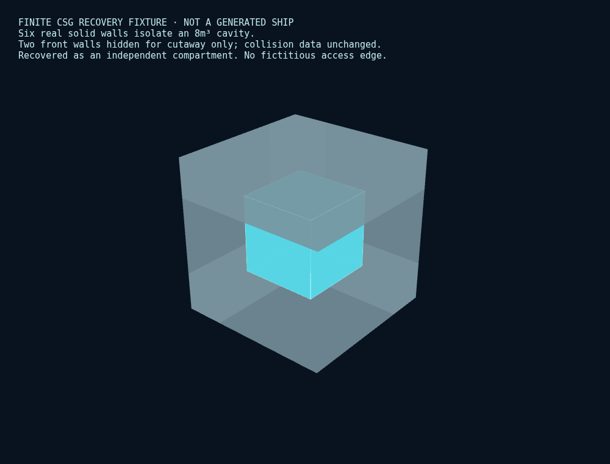

# V1.8.6.2.1 — Interior Performance & Volume Integrity

Base `04e9ede7fb4b1a15743b527e08ee6d01ec0f1720` / `feature/v1.8.6.2`. 작업 `/workspace/shipyard-v1.8.6.2.1`, `feature/v1.8.6.2.1`. 최종 SHA는 완료 응답과 `git log -1`에 기록된다. 기존 worktree·QA·combat-demo를 보존했다. Remote Push/Force Push 없음.

## 실제 변경

기존 유한 CSG 추출·물리 재료·격벽·opening·그래프를 유지했다. 다른 생성기를 만들지 않았다.

- 반대 방향 face normal을 .01 bin으로 broad phase 분류해 연결 후보 탐색을 줄였다. 원래 dot<=-.999999 조건의 가능한 normal 편차는 .001415 이하이므로 주변 27 bin이 모든 후보를 포함한다. 실제 normal은 양자화하지 않으며 기존 평면·유한 polygon·면적 판정은 동일하다.
- 동일한 정확한 source input을 가진 생성/검증이 occupancy 변환·공간 인덱스를 공유한다. 검증 후 context를 해제한다. convex point set이 정확히 같은 domain의 유한 union 체적/중심/참조를 context 안에서만 재사용한다(최대 128개). 수정된 좌표는 재사용하지 않는다. 임의의 유효성 검사를 무조건 통과시키지 않는다.
- 새 source key는 실제 소비하는 Frame envelope/host/station, Hull/Armor solid 및 재질 ID, Order, Structural Volume, core solid를 포함한다. 사용하지 않는 Frame graph와 exclusive material 복제 데이터를 identity에 다시 넣지 않는다. 시간·캐시 상태는 Blueprint에 저장하지 않는다. 구버전 .2 signature 계약은 보존한다.
- Interior cache 마지막 1개는 mutable plan 복제 대신 lossless JSON을 보관하고 매 hit마다 독립 객체로 복원한다. validation은 정확한 전체 내용 키 마지막 1개와 weak object cache를 쓴다. source/plan mutation은 다시 검증한다.
- Query는 전체 CSG Blueprint를 다시 복제하지 않고 필요한 topology metadata와 실제 유한 plane/bounds snapshot을 보관한다. fit은 같은 finite halfspace 차집합을 사용한다. 이전 함선 query를 viewer 교체/해제 때 명시적으로 해제한다. 원본 occupancy context 구축을 별도 helper scope에 두어 반환 query closure가 원래 Frame/source maps를 잡지 않게 했다. 반환 access metadata도 독립 복사다.
- 렌더러의 장기 room JSON/geometry cache를 제거했다. dispose는 실제 geometry/material, shadow, scene, Blueprint 참조, canvas를 해제한다. Normal에서는 내부 시각화/query를 생성하지 않는다. 과거 Blueprint 전환에서 사라진 Frame/Interior/Physical Inspector의 오래된 onchange 참조도 지운다. 실제 Production native → 과거 무장 Blueprint 전환으로 Frame/Interior callback null을 확인했다(`ui/callback-release.json`).
- 기존 생성 경로에 잔여 분류/복구와 volume audit를 추가했다. 신규 Native 기본은 .2.1이고 explicit .2/.1/.0.2 재현 경로를 유지한다. 최상위 schemaVersion 2, optional compartmentPlan schemaVersion 1 및 명시적 plan version을 사용한다. Load만으로 과거 구획을 갱신하지 않는다.

## 체적 계약과 한계

`volumeAudit`는 실제 exclusive extracted bay domain을 분모로 한다. 전체 함선 Bounding Box 비율이 아니다. `ASSIGNED`는 확인된 경계를 가진 등록 공간, `USABLE_RESIDUAL`은 .5m cube witness가 있으나 별도 partition 경계 소유가 미완성인 공간, `NONALLOCATABLE`은 현재 보수적 정책의 witness를 찾지 못한 실제 유한 void다. 좁고 긴 체적을 총 m³만으로 적합 판정하지 않는다. .5m cube witness 실패는 모든 회전·모든 작은 장비의 불가능성 증명이 아니다.

`UNRESOLVED`인 등록 chamber도 confirmed assigned/valid m³에서 제외한다. source 외피·중공 계약이 없는 SPINE/보강 stock 등은 `unquantifiedRegionIds`와 기존 region reason으로 별도 기록한다. 그 영역의 실제 빈 체적을 알 수 없으므로 0m³로 해결됐다고 주장하거나 gross envelope를 빈 공간에 더하지 않는다.

Valid ≈ Assigned + Usable Residual + Nonallocatable. 별도로 candidate domain - existing solid union - main chamber - all disconnected pockets의 수치 잔차를 기록한다. 복구된 pocket은 assigned에 한 번만 포함한다. 원래 wall face 사이의 bay 분모이므로 partition slab은 제외한다. 실제 wall/closure 재료와 OPEN aperture tube의 공간은 기존 massAccounting/spatialAccounting에 별도로 남는다. 이는 전체 ship 내부의 완전한 material/air voxel census가 아니다. 등록 chamber가 없는 완전 고체/비중공 후보와 source 계약이 없는 region의 전역 체적 총량까지 이 분모가 포괄한다고 주장하지 않는다. 겹침 기대값 0은 independent finite pair 검사(허용 1e-5m³)로 검사하며 무한 정밀도 0을 인증하지 않는다.

| 설계 | 구획/벽/개구 | confirmed assigned m³ | usable residual m³ | nonallocatable m³ | unresolved finite candidate m³ | solid in bay m³ | conservation error m³ |
| --- | --- | --- | --- | --- | --- | --- | --- |
| BALANCED | 3/2/2 | 9,900,977.371 | 0 | 3.3433088e-08 | 0.00010751232 | 9,367.596 | -0.00025488471 |
| ARMOR | 4/3/2 | 10,979,595.749 | 0 | 6.2708358e-08 | 0.000 | 12,735.533 | -8.9618687e-05 |
| MOBILITY | 2/1/1 | 9,749,939.461 | 0 | 3.497775e-08 | 0.000 | 7,394.253 | -0.00011486146 |
| ENDURANCE | 6/5/5 | 10,597,225.270 | 0 | 9.9621228e-08 | 0.000 | 12,194.936 | -9.5085211e-05 |
| ECONOMY | 2/1/1 | 9,902,464.803 | 0 | 3.2660186e-08 | 0.000 | 8,794.742 | -1.7630575e-06 |
| BLOCK_ASSEMBLY | 8/4/4 | 2,263,969.440 | 0 | 0.28900948 | 106,413.445 | 29,447.382 | -8.333028e-08 |
| SPINE_AND_MODULES | 8/4/4 | 348,444.468 | 0 | 9.5753633e-08 | 79,598.089 | 15,837.741 | -3.0987769e-05 |
| TRUSS_POD | 12/6/7 | 683,390.542 | 0 | 1.8407525e-07 | 71,071.470 | 10,627.171 | -5.6474507e-06 |
| TWIN_HULL | 8/5/5 | 2,052,975.811 | 0 | 6.5069461e-06 | 0.000 | 14,504.315 | 7.6714892e-07 |
| CORE_AND_NACELLES | 10/5/5 | 127,348.684 | 0 | 2.7692392e-07 | 12,640.483 | 4,124.326 | -0.00047610885 |
| STACKED_BLOCKS | 4/1/3 | 2,215,728.670 | 0 | 1.2763368e-07 | 0.000 | 10,306.308 | -5.639583e-07 |
| HYBRID | 8/4/6 | 233,905.059 | 0 | 0.00016689425 | 180,691.581 | 23,418.986 | -9.634294e-05 |

기존 .2는 작은 독립 pocket을 모두 미해결 잔여 목록에 넣었으며 큰 chamber의 geometric volume과 pressurizable volume을 따로 기록했다. 이번 표의 confirmed assigned와 과거 raw chamber 합계를 같은 의미로 비교하지 않는다. 실제 기존 chamber/벽/문 형상과 mass는 아래 통제 비교에서 동일함을 확인했다.

### 같은 정의의 Before / After 및 비율

| 설계 | 기존 geometric assigned m³ | 새 geometric assigned m³ | 기존 미분류 residual m³ | 새 valid / candidate domain % | 미확정 finite / candidate % |
| --- | --- | --- | --- | --- | --- |
| BALANCED | 9,900,977.371 | 9,900,977.371 | 0.00010754575 | 99.90548 | 0.00000 |
| ARMOR | 10,979,595.749 | 10,979,595.749 | 6.2708358e-08 | 99.88414 | 0.00000 |
| MOBILITY | 9,749,939.461 | 9,749,939.461 | 3.497775e-08 | 99.92422 | 0.00000 |
| ENDURANCE | 10,597,225.270 | 10,597,225.270 | 9.9621228e-08 | 99.88506 | 0.00000 |
| ECONOMY | 9,902,464.803 | 9,902,464.803 | 3.2660186e-08 | 99.91127 | 0.00000 |
| BLOCK_ASSEMBLY | 2,370,382.886 | 2,370,382.886 | 0.28900948 | 94.33873 | 4.43421 |
| SPINE_AND_MODULES | 428,042.557 | 428,042.557 | 1.3864032e-07 | 78.49965 | 17.93233 |
| TRUSS_POD | 754,462.012 | 754,462.012 | 2.0724631e-07 | 89.32168 | 9.28931 |
| TWIN_HULL | 2,052,975.811 | 2,052,975.811 | 6.5069461e-06 | 99.29845 | 0.00000 |
| CORE_AND_NACELLES | 139,989.167 | 139,989.167 | 2.9931811e-07 | 88.36694 | 8.77120 |
| STACKED_BLOCKS | 2,215,728.670 | 2,215,728.670 | 1.2763368e-07 | 99.53701 | 0.00000 |
| HYBRID | 414,596.640 | 414,596.640 | 0.00016691781 | 53.40108 | 41.25231 |

## Residual Recovery

실제 void cell의 유한 공유 면으로 connected component를 나눈다. 충분한 clearance를 가진 독립 성분 중 partition 면과 떨어져 있고 기존 solid/외부 gap/불확실 접합에 막히지 않는 성분만 독립 구획으로 복구한다. 새 node에 가상의 passage를 만들지 않는다. partition 인터페이스를 재설계해야 하는 경우 usable residual로 유지하며 무조건 main chamber에 합치지 않는다. 실패한 triangulation은 정상 공간으로 등록하지 않는다.

제한된 대표 실제 설계의 잔여 성분은 모두 작거나 좁아 새 .5m witness 기반 복구 구획 수는 0이다. 이 결과를 실제 함선의 대규모 공간 복구 성공으로 주장하지 않는다. 같은 CSG/연결/복구 함수를 사용하는 별도 유한 기하 Fixture에서 6개 실제 고체 벽의 합집합이 8m³ 공동을 분리하고 별도 compartment로 복구됨을 검증했다. 벽/통로/질량을 새로 꾸미지 않았다. 아래 이미지는 **실제 브라우저에서 실행한 mathematical fixture**이며 실제 생성 함선 스크린샷과 구분한다.

## 조회 / 미래 배치

`prepareInteriorQueries`: availableVolume / at / occupancyAt / unresolvedCandidates / fits / placementCandidates / probe. 작은·중간·큰 시험 OBB, 회전, clearance margin, 실제 고체·벽·Hull 밖·미확정 경계 거절을 검사했다. 후보는 최대 64개 실제 convex cell anchor/confirmed compartment 및 최대 32개 결과의 bounded search다. 전체 packing 해법이나 모든 가능한 위치를 찾았다는 보장은 없다. 전체 체적만으로 설치를 허용하지 않는다. 반환된 위치의 실제 expanded OBB가 유한 연결 공간 안에 있고 고체와 겹치지 않아야 한다. source bounds는 broad phase이고 실제 경계가 아니다.

센서/원자로/탄약고 등 기능성 설비는 생성하지 않았다. 이 API는 내부용이며 외부 Free-Mount 설치 조건에 연결하지 않았다. access metadata는 실제 portal/group 참조이며 설계/instance 상태를 변경하지 않는다. EXPOSED/UNRESOLVED 공간은 현재 보수적 confirmed-interior 배치 정책에서 허용하지 않는다.

## 물리·질량·연결 회귀

12개 고정 설계(8종 Architecture + 추가 4개 priority)에서 완성 compartment geometry/data 전체도 해시 일치했다.  기존 Hull/Armor/Frame/Connector/engine/prefab/Meso/weapon layout을 해시 비교했다. Bulkhead/Openings/Mass/Isolation도 동일하다. 기존 외부 36 ray, 내부 36 ray 및 Frame 36 ray의 실제 material/Entry/Exit/normal/LOS/order를 같은 Node 환경에서 비교했다. cache hit/miss JSON, 실제 generation/import, hard maximum rejection, legacy saved equipment, 자유 함포와 미사일 설치를 검사했다. 공간 자체는 질량이 없으며 별도 물리 벽/leaf가 늘지 않은 대표 설계의 mass delta는 0kg다.

CORE의 기존 solid connector를 중공으로 바꾸지 않았고 그 실제/기존 질량을 유지했다. TRUSS에는 포드 공간만 있고 lattice가 방이 되지 않는다. SPINE 외피 계약의 불확실성은 그대로 기록한다. TWIN_HULL 구조 연결과 access/pressure를 분리한다. STACKED는 실제 해치만 연결한다. 가상 breach/문 상태/벽 상실은 design/질량을 변경하지 않는다. 실제 압력·산소·화재·파괴·새 내부 설비는 없다.

## 성능 측정

실행 자원: cgroup CPU quota `200000/100000` (평균 2 CPU), memory limit `8589934592` (8GiB). OS가 보고한 logical CPU 3개와 실제 quota를 구별한다.

Same container, fresh Node processes ×3 per version, same old harness and full old fixture input retained for comparable RSS. No concurrent tests/browser. Module import separate, generation excludes import/startup; explicit query follows repeat. p95 with n=3 is sample max. Separate --expose-gc order-only conditions probe cold/warm hit/all target caches cleared/changed seed, CPU/heap/serialization/query; not pooled with the three-sample timings. Extra architecture n=1 each and small instrumentation-off samples, not a statistical overhead isolation.

| 버전 | cold median/p95 s | warm hit median/p95 s | max process RSS MiB | interior cache estimate MiB | validation key estimate MiB |
| --- | --- | --- | --- | --- | --- |
| before | 10.367/12.137 | 2.561/2.612 | 1202.1 | 46.0 | 46.0 |
| after | 8.430/8.475 | 2.361/2.375 | 1022.0 | 40.9 | 40.9 |

| 추가 n=1 | before cold/warm s | after cold/warm s | before/after RSS MiB |
| --- | --- | --- | --- |
| CORE_AND_NACELLES | 35.739/7.109 | 28.820/5.551 | 2335.1/2222.3 |
| TRUSS_POD | 28.846/8.441 | 23.866/7.808 | 2139.7/2051.0 |
| SPINE_AND_MODULES | 15.685/4.058 | 13.932/3.692 | 1411.5/1443.3 |
| SMALL | 9.943/1.791 | 7.826/1.552 | 784.9/758.2 |

별도 order-only protocol (--expose-gc): source fixture 전체를 보관하지 않고 실제 작은 order JSON만 읽는다. 같은 process에서 명시적으로 target design/frame/integration/source/physical validation/interior validation cache를 비운 warm miss와 changed seed를 구분한다. 계측용 clear hook은 baseline source를 수정하지 않고 읽기 전용 bundle에서만 주입했다. common runtime 초기화/JIT가 따뜻한 상태는 의도적으로 유지한다.

### before conditions

| 상태 | wall s | CPU s | serialization ms | post-GC heap MiB | stage RSS highwater MiB |
| --- | --- | --- | --- | --- | --- |
| COLD | 10.623 | 13.337 | 243.94 | 166.2 | 666.8 |
| WARM_HIT | 2.855 | 3.469 | 218.49 | 174.4 | 763.9 |
| WARM_MISS | 10.552 | 12.780 | 247.50 | 174.4 | 819.6 |
| CHANGED_DESIGN | 11.183 | 13.243 | 254.78 | 181.9 | 943.1 |

Query preparation 600.80ms / ray 4.40ms / 12971 finite query cells. Module import 25.45ms. Environment: `{'node': 'v24.19.0', 'os': '6.18.44', 'cpu': 'AMD EPYC 9V74 80-Core Processor', 'logicalCpus': 3, 'platform': 'linux', 'execArgv': ['--expose-gc']}`.

### after conditions

| 상태 | wall s | CPU s | serialization ms | post-GC heap MiB | stage RSS highwater MiB |
| --- | --- | --- | --- | --- | --- |
| COLD | 8.656 | 11.258 | 271.51 | 157.0 | 680.2 |
| WARM_HIT | 2.828 | 3.420 | 227.45 | 165.0 | 749.1 |
| WARM_MISS | 8.310 | 10.487 | 197.47 | 165.1 | 776.4 |
| CHANGED_DESIGN | 7.621 | 9.204 | 235.01 | 172.4 | 975.0 |

Query preparation 539.12ms / ray 5.68ms / 12971 finite query cells. Module import 24.11ms. Environment: `{'node': 'v24.19.0', 'os': '6.18.44', 'cpu': 'AMD EPYC 9V74 80-Core Processor', 'logicalCpus': 3, 'platform': 'linux', 'execArgv': ['--expose-gc']}`.

RSS는 Node 프로세스 highwater이며 브라우저/GPU 값과 합산하지 않는다. 캐시 바이트는 UTF-16 JSON 저장량 추정이지 JS 객체 크기 실측이 아니다. post-GC heap에는 active ship 및 기존 global caches도 포함된다. Node startup/import와 순수 generation을 구분했다. CPU sampling profiler는 별도 실행했고 성능 목표의 3회 중앙값에는 섞지 않았다. 작은 별도 profiling-off 표본은 오버헤드 참고용이며 n=1/서로 다른 harness 조건이므로 정확한 overhead percent로 주장하지 않는다. 개별 Vector/Cell allocation 수와 모든 triangle/intersection call 수는 별도 계측하지 않았다.

### before CPU profile

| self sampled function | parent | sample ms |
| --- | --- | --- |
| (garbage collector) | (root) | 872.3 |
| visit | visit | 581.6 |
| clipCell | subtractCell | 323.5 |
| visit | visit | 317.5 |
| clipCell | intersectCells | 294.7 |
| visit | visit | 184.4 |
| subtractCell |  | 166.2 |
| interiorInput |  | 155.9 |
| structuredClone |  | 154.3 |
| visit | visit | 144.8 |
| validatePhysicalDesign | validateBlueprint2 | 143.0 |
| interiorInput | checkCompartmentPlan | 142.1 |

| generation stage | ms / calls |
| --- | --- |
| Interior cache miss | 0.000 / 1 |
| Interior exterior boundary audit | 114.573 / 1 |
| Interior volume accounting | 512.156 / 3 |
| Interior void connectivity | 1239.574 / 3 |
| Interior bulkhead and openings | 62.788 / 2 |
| Interior extraction and partition | 2104.725 / 1 |
| Interior module interfaces | 0.338 / 1 |
| Interior graph construction | 0.258 / 1 |
| Interior isolation analysis | 0.599 / 1 |
| Interior mass accounting | 0.059 / 1 |
| Interior total | 2445.880 / 1 |
| Interior geometry validation | 3690.786 / 1 |

### after CPU profile

| self sampled function | parent | sample ms |
| --- | --- | --- |
| (garbage collector) | (root) | 766.3 |
| clipCell | subtractCell | 258.6 |
| clipCell | intersectCells | 159.2 |
| validatePhysicalDesign | validateBlueprint2 | 136.8 |
| structuredClone |  | 134.2 |
| subtractCell |  | 131.4 |
| clipCell | subtractCell | 126.9 |
| subtractCell |  | 117.3 |
| checkCompartmentPlan |  | 115.6 |
| interiorInput |  | 115.1 |
| (anonymous) | timedPhysical | 110.6 |
| mergeConvexCells | addPhysicalDesign | 107.7 |

| generation stage | ms / calls |
| --- | --- |
| Interior cache miss | 0.000 / 1 |
| Interior exterior boundary audit | 104.187 / 1 |
| Interior volume accounting | 485.729 / 3 |
| Interior solid exclusion | 584.841 / 3 |
| Interior void connectivity | 172.406 / 3 |
| Interior residual classification | 118.205 / 3 |
| Interior bulkhead and openings | 49.312 / 2 |
| Interior extraction and partition | 1671.513 / 1 |
| Interior module interfaces | 0.364 / 1 |
| Interior graph construction | 0.212 / 1 |
| Interior isolation analysis | 0.548 / 1 |
| Interior mass accounting | 0.051 / 1 |
| Interior total | 1979.139 / 1 |
| Interior geometry validation | 1532.835 / 1 |

### CPU sampled self aggregate (stack recursion 합산 제거)

| 함수 | before ms | after ms |
| --- | --- | --- |
| visit | 2357.82 | 680.16 |
| clipCell | 1040.01 | 812.32 |
| subtractCell | 415.17 | 390.35 |
| interiorInput | 426.23 | 208.85 |
| structuredClone | 231.02 | 150.43 |
| checkCompartmentPlan | 129.65 | 115.64 |
| connectedVoidCells | 78.05 | 144.62 |
| (garbage collector) | 872.29 | 766.26 |

`visit`은 주로 기존 boundsIndex 재귀 탐색이다. self sample을 함수 이름별 합산했으며 inclusive 재귀 프레임을 중복 더하지 않았다. 각 sampling 1ms, 별도 단일 cold 표본이다.

목표: cold <=8s **MISS**, repeated <=3s **PASS**, max process RSS <=950MiB **MISS**. 목표 미달을 숨기거나 좋은 cache hit 숫자로 cold 값을 대체하지 않았다. 복잡한 CORE/TRUSS와 대형 source/Frame 캐시 비용은 계속 추적해야 한다.

SPINE n=1 RSS는 1,411.5→1,443.3MiB로 증가했다. 별도 changed-seed 조건의 process highwater도 943.1→975.0MiB로 증가했다. 모든 설계·조건에서 RSS가 감소했다고 주장하지 않는다. retained heap과 highwater를 구별한다.

## 실제 브라우저 / 메모리

Chromium + SwiftShader. 저장 Blueprint의 Normal 8척 pixel/DrawCall 일치, 6개 view/finite mesh picking을 검사했다. 실제 Production UI native 8종 Generate와 각 동일 브라우저 반복 JSON byte equality, 마지막 diagnostics/legacy/mobile를 합쳐 21개 고유 checks. 생성 matrix는 `native-ui-bounded.log`에서 통과했고 닫힌 진단 accordion/좁은 화면 문제를 수정한 뒤 그 8종 증거를 보존해 tail만 재개했다(`native-ui-complete.log`). 별도 편집/legacy/gear UI 37 checks. Console/page error lists: native 0, editor 0. 큰 전체 UI 전수/무관한 combat QA는 하지 않았다.

| browser cycle | design | debug geometry count | normal geometry count | post-GC JS heap MiB |
| --- | --- | --- | --- | --- |
| 0 | BALANCED | 6 | 29 | 45.7 |
| 1 | TWIN_HULL | 6 | 91 | 130.1 |
| 2 | BALANCED | 6 | 29 | 46.5 |
| 3 | TWIN_HULL | 6 | 91 | 130.7 |
| 4 | BALANCED | 6 | 29 | 46.9 |
| 5 | TWIN_HULL | 6 | 91 | 130.9 |

Dispose result: `{'blueprintReleased': True, 'shipReleased': True, 'geometryCount': 0, 'sceneChildren': 0}`. GC 변동과 제한된 6회 조건만 검사했다. GPU byte allocation/장기간 leak-free를 인증하지 않는다. Query cache는 live object weak ownership이며 전체 다함선 aggregate memory budget은 아직 없다.

추가로 Inspector의 긴 구획 선택 ID가 390px 화면에서 30px 넘치는 실제 오류를 발견했다. label/select 폭을 Inspector 안으로 제한했고 390px no-page-overflow를 재검증했다.

### Node reference / 실제 Production Chromium 값

| 설계 | Node base t | Chromium base t | 차이 kg |
| --- | --- | --- | --- |
| BALANCED | 628,103.585 | 628,103.585 | 0 |
| BLOCK_ASSEMBLY | 1,003,069.874 | 1,003,069.874 | 0 |
| SPINE_AND_MODULES | 247,319.657 | 247,345.492 | 25834.5054 |
| TRUSS_POD | 240,528.863 | 240,528.863 | 0 |
| TWIN_HULL | 542,525.924 | 542,525.924 | 0 |
| CORE_AND_NACELLES | 342,352.407 | 342,352.407 | 0 |
| STACKED_BLOCKS | 226,502.359 | 226,502.359 | 0 |
| HYBRID | 282,591.475 | 282,591.478 | 2.42328537 |

SPINE의 이전/이후 Production Chromium 전체 구획·벽·개구부·그래프·질량은 exact equality였다. 다른 모든 cross-runtime 수치 차이의 원인을 이 패치에서 완전히 규명했다고 주장하지 않는다. Node-vs-Node 12개 물리 보존과 Chromium-vs-Chromium 반복 byte equality를 구분한다.

## 발견한 실패 실험 / 남은 한계

- 초기 targeted run의 긴 CPU section을 중단했다. 잔여 셀 검증에서 본실 전체를 순회하던 경로를 실제 bounds index로 고쳤고 oversized placement에는 source bounds broad phase를 추가했다. 당시 54개 기존 사례는 통과했지만 정상 종료로 집계하지 않았다.
- 브라우저 QA와 동시에 실행한 run은 66/67 통과, 60s native test timeout 1건 및 worker RPC 오류였다. 제한값을 늘리지 않고 단독 실행해 4파일 67개 모두 통과했다. 실패 로그를 보존한다.
- 최초 새 UI QA의 Node-vs-Chromium full JSON equality는 실패했다. 기존 prefab trig의 ULP 차이뿐 아니라 canonical face fan 순서 차이가 있었다. 정렬한 유한 point set/체적으로 검사해도 SPINE mass에는 약 25.8t 차이가 있어 이를 허용오차로 숨기지 않았다. 같은 **Production Chromium**에서 이전 .2와 새 .2.1의 SPINE을 생성해 physical skin/Frame/mass/compartment/walls/openings/graphs/isolation이 정확히 같음을 확인했다(`ui/cross-runtime-audit.json`). 이는 기존 실행 환경 간 수치 커널 부채이며 이번 패치에서 해결하지 않았다. Node 통제 비교와 same-browser repeat 결정성은 별도 결과다. 플랫폼 간 모든 Blueprint bit identity를 주장하지 않는다.
- 새 QA의 optional maximum 값을 항상 존재한다고 비교한 오류를 수정했다. maximum이 없는 주문에는 soft target을 hard cap으로 새로 해석하지 않았다.
- 대형 CORE의 반복 UI/export audit에서 page가 종료됐다. 당시 공유 cgroup highwater는 8GiB, 누적 OOM-kill counter는 1이었다. 실패 전 counter와 per-process OOM victim trace는 별도 확보하지 않아 이 run의 유일한 원인을 단정하지 않는다. QA가 여러 대형 export를 중복 파싱/보유하던 경로를 줄여, 최종 검증은 한 번에 한 QA root만 파싱하고 반복 determinism은 실제 exported bytes digest로 비교한다. Node GC와 Chrome의 case 후 GC를 명시했고 메모리는 별도 지표로 기록했다. 최종 bounded 8종 검증 후 OOM counter는 1로 추가 증가하지 않았다. 이 실패를 실제 제품의 무제한 메모리 안정성 통과로 바꾸지 않는다. 여전히 실제 대형 Blueprint와 existing Frame/source cache의 메모리 비용이 크다.
- 별도 source-only memory/fixture QA에서 gzip Content-Encoding을 다시 압축 해제해 fetch가 실패한 실험도 있었다. 실제 응답 header를 확인해 이미 브라우저가 해제한 body는 그대로 사용하도록 수정했다. Production import/export나 실제 physical geometry를 생략하지 않았다.
- 일반화된 모든 잔여 공간 구획화/추가 partition boundary 소유, SPINE 미정 외피, 완전한 interior total census는 미완료다. 현재 대표 실제 설계의 새 복구량은 0이고 8m³ positive fixture를 별도로 보고한다.
- 배치 후보 탐색은 보수적/제한적이다. candidate 없음은 수학적 packing 불가능성의 증명이 아니다. 실제 reactor/armory/air/pressure/crew/structural failure runtime은 없다.

## 테스트 / Build / 자료

`npx vitest run tests/interior-stability.test.ts tests/interior.test.ts tests/free-mount.test.ts tests/physical-foundation.test.ts --maxWorkers=1`: 4파일 67개 단독 실행 통과. 마지막 반환 access metadata 독립성/회전 OBB, 실제 Frame·격벽 고체 거절, 1,000m³이지만 폭 .1m인 연속 공간 거절 보강은 같은 배치 사례만 별도 재실행했다(`placement-contract-final.log`, 1개 통과). 고유 테스트 수를 중복 합산하지 않는다. `npm run build`의 TypeScript --noEmit + Production Build 통과(`build-final-complete.log`). 기존 >500KB JS chunk 경고는 남는다. 전체 600개 이상 suite/역사 전체 pixel/무관한 combat/대규모 random Seed는 실행하지 않았다.

[실제 화면 갤러리](index.html), [체적·물리 통제 비교](controlled-comparisons.json), [성능 원본](performance/summary.json), [Production native 결과](ui/native-generation.json), [메모리 6회](memory/browser-cycles.json), [SPINE 동일 실행 환경 감사](ui/cross-runtime-audit.json). 과거 QA 파일을 덮어쓰지 않았다.

### 실제 변경 파일

- `package-lock.json`
- `package.json`
- `src/blueprint/types.ts`
- `src/interior/build.ts`
- `src/interior/connectivity.ts`
- `src/interior/geometry.ts`
- `src/interior/query.ts`
- `src/interior/types.ts`
- `src/interior/validate.ts`
- `src/interior/volume.ts`
- `src/procurement/generate.ts`
- `src/rendering/interior.ts`
- `src/rendering/viewer.ts`
- `src/structure/validate.ts`
- `src/style.css`
- `src/ui/interior.ts`
- `src/ui/layout.ts`
- `src/ui/physical.ts`
- `src/ui/structure.ts`
- `src/validation/validate.ts`
- `tests/interior-stability-benchmark.mjs`
- `tests/interior-stability-browser.mjs`
- `tests/interior-stability-callbacks.mjs`
- `tests/interior-stability-compare.mjs`
- `tests/interior-stability-controls.mjs`
- `tests/interior-stability-final-qa.mjs`
- `tests/interior-stability-harness.mjs`
- `tests/interior-stability-memory.mjs`
- `tests/interior-stability-native-ui-audit.mjs`
- `tests/interior-stability-native-ui.mjs`
- `tests/interior-stability-performance.mjs`
- `tests/interior-stability-profile.mjs`
- `tests/interior-stability-recovery-browser.mjs`
- `tests/interior-stability-runtime-audit.mjs`
- `tests/interior-stability-ui.mjs`
- `tests/interior-stability.test.ts`
- `tests/interior.test.ts`

실행: 이 worktree에서 `npm run dev`. 검증은 위 선택 명령. 원격 Push 없음.
