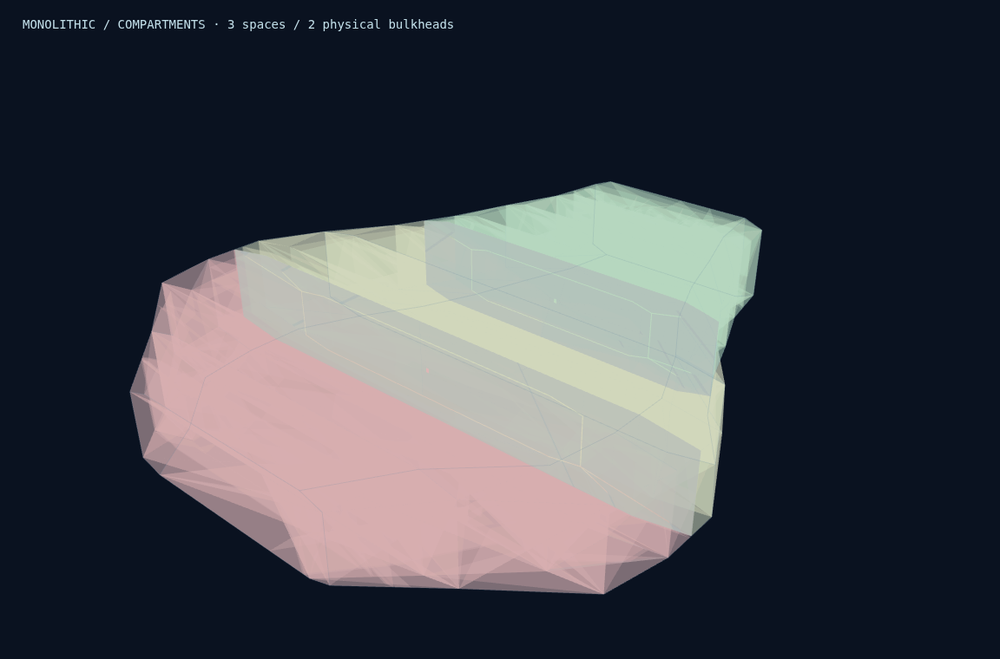
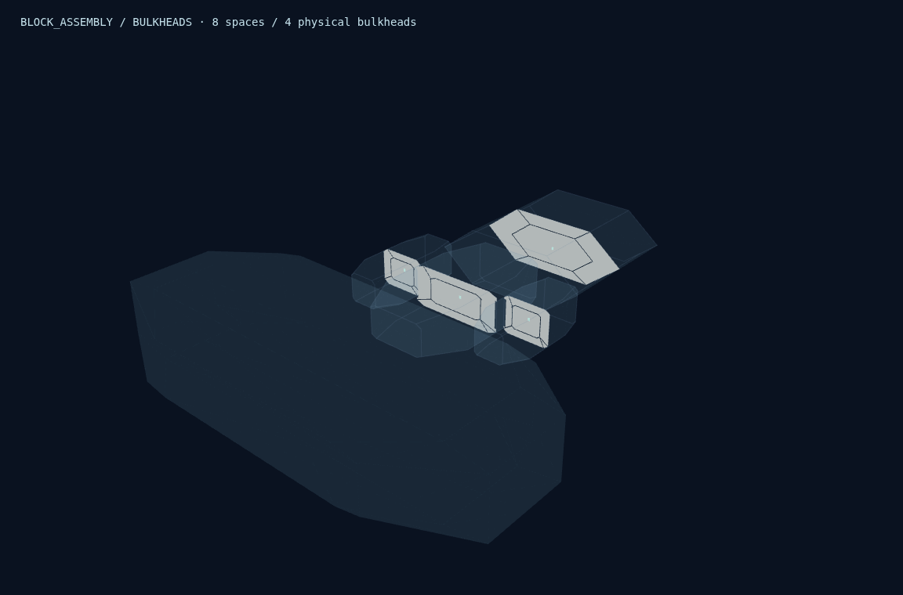
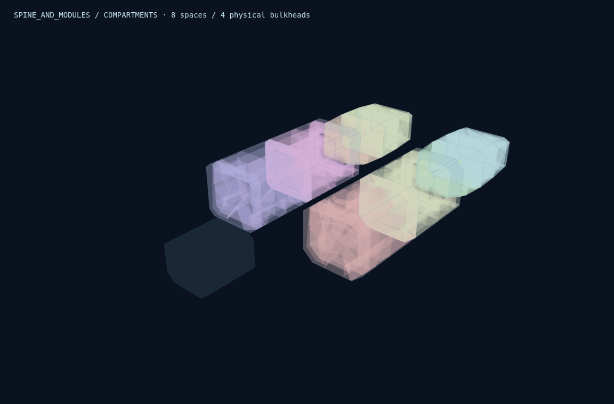
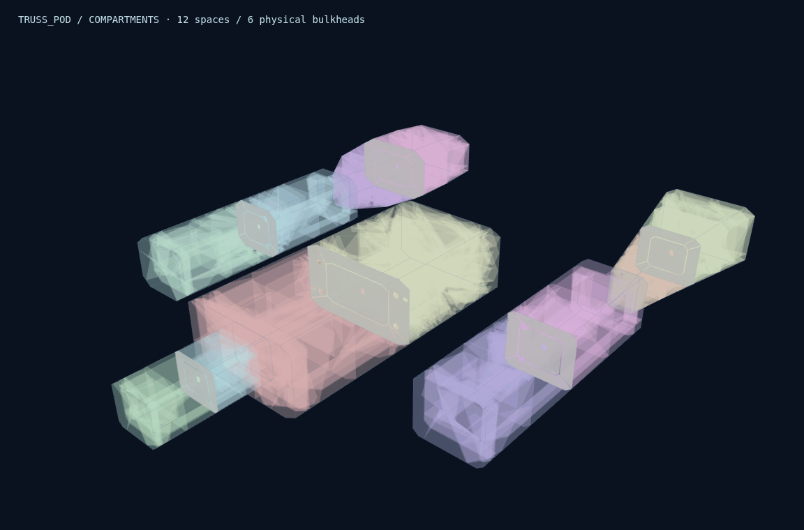
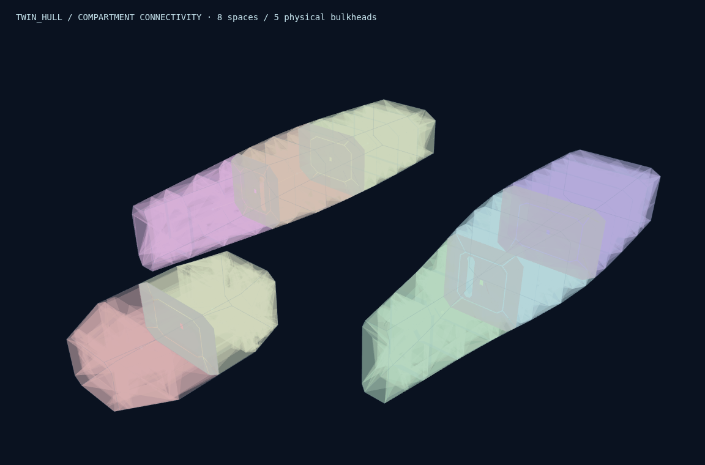
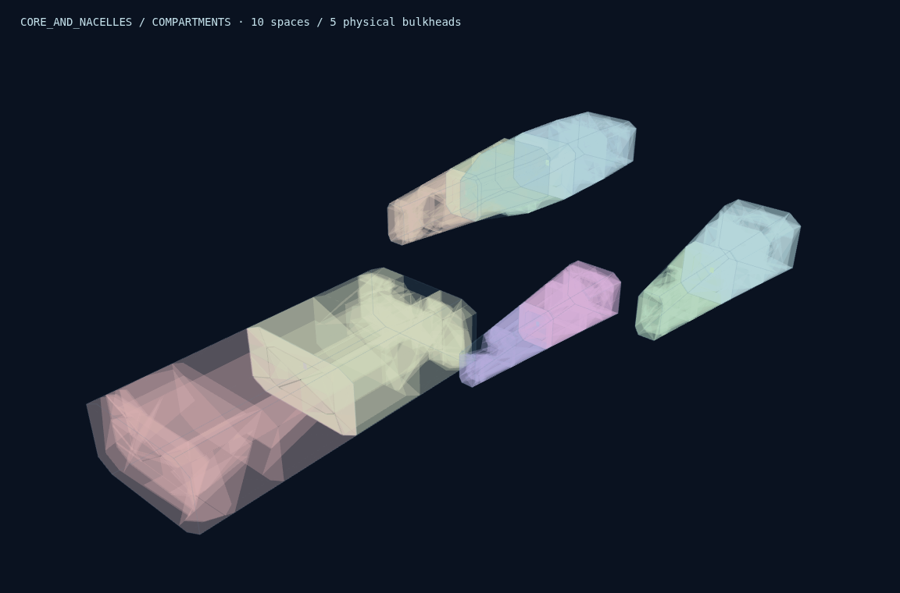
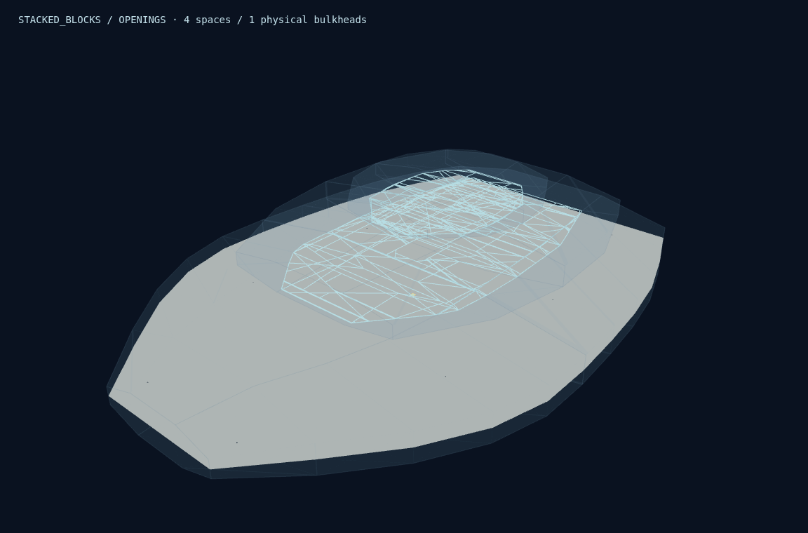
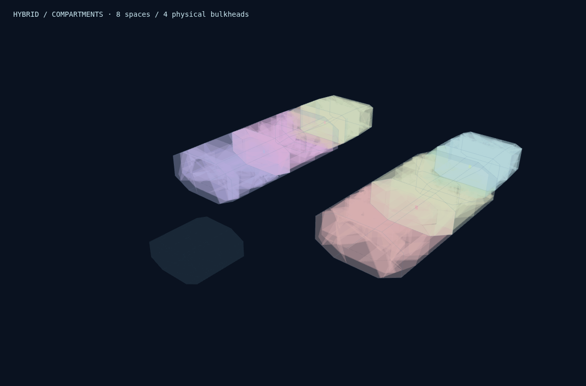
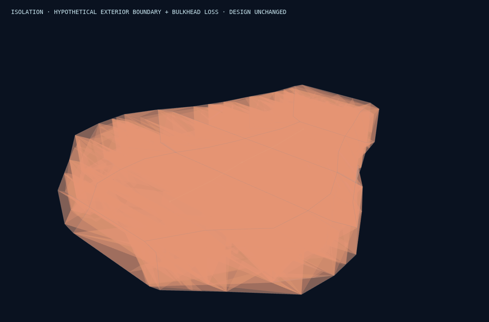
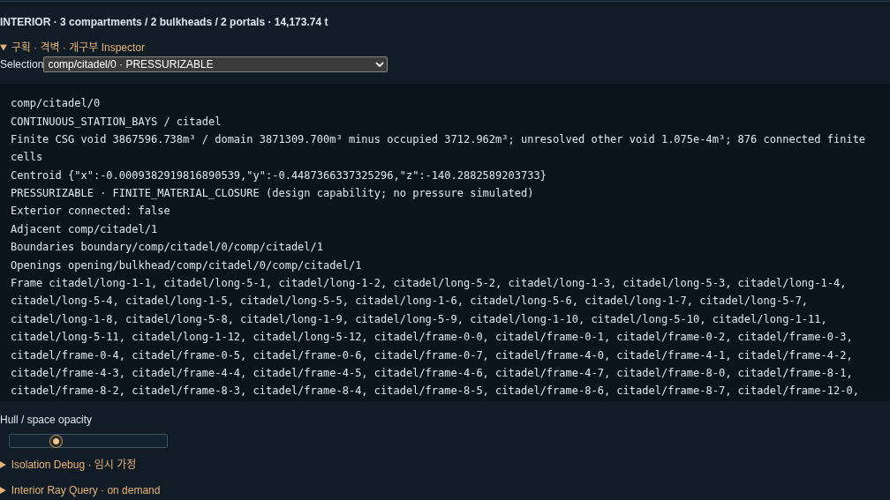

# V1.8.6.2 — Compartments & Bulkheads QA

기준 `4f7839b5d4a62778b83c9dd00309fac4af2648fa`, `feature/v1.8.6.1`. 작업 `feature/v1.8.6.2`, `/workspace/shipyard-v1.8.6.2`. 기존 `work`와 다른 worktree, 기존 QA 및 combat-demo를 보존했다. 원격 Push/Force Push는 없다. 최종 Commit SHA는 완료 응답 및 이 브랜치의 `git log -1`에서 확인한다.

## 구현과 검증 범위

Native Procurement의 기본 생성 버전을 1.8.6.2로 확장했다. Hull → Frame → Physical Skin 다음에 Interior Extraction / Partition / Bulkheads / Openings / Graph / Mass를 수행하고 기존 출고 검증으로 최종 기본 질량·비용 상한을 검사한다. `{version:'1.8.6.1'}`와 `{version:'1.8.6.0.2'}`는 이전 계약을 명시적으로 재현한다. 일반 Blueprint Load는 재설계하지 않는다.

최상위 schemaVersion 2를 유지하고 선택적 `compartmentPlan`(schemaVersion 1, version 1.8.6.2)을 추가했다. 기존 `structuralFrame` 데이터는 변경하지 않았다. 새 데이터에는 실제 공간·경계·격벽·개구부·원본 점유 참조·접근/압력 그래프·미해결 공간·질량/예산·근사 정보가 저장된다. Runtime의 문 상태/비활성 경계/가상 외피 개방은 별도 `InteriorInstanceState`로 분리했다.

## 실제 내부 공간 추출

기존 `physicalSources`의 닫힌 유한 Hull 체적을 사용한다. Bounding Box를 방으로 사용하지 않는다. 실제 station-loft/convex cell에서 겹친 Hull의 공간 소유권을 분리한 후 다음 재료를 유한 CSG로 제외한다.

- 실제 Hull/Armor skin의 물리 셀
- Frame·기존 Connector의 실제 construction envelope 합집합
- 기존 assembly part의 닫힌 고체 형상

Frame의 exclusive 재료와 Skin을 합친 영역은 construction envelope와 Skin의 합집합과 같다. 따라서 세분화된 수천 개의 ownership 조각을 재복제하지 않고도 같은 점유 합집합을 사용할 수 있다. 점유 체적 계산은 교집합/차집합과 안정적인 소유 순서로 중복을 제거한다. Core assembly의 재료 상세는 기존 추정 모델이며, 새 원자로/탄약고/장식용 기능 설비를 만들지 않는다. 등록되지 않은 시각용 Meso를 새로운 물리 재료로 간주하지 않는다.

공간 분할은 실제 Frame Station, Hull 단면 변화 및 모듈 경계를 사용한다. 최대 분할 수와 최소 길이를 제한했다. STACKED_BLOCKS는 수평 deck 경계와 실제 HATCH를 사용하고, 다른 구조는 해당 모듈의 종방향 station을 사용한다. HYBRID는 실제 POD/NACELLE/HULL 구성별 문법을 적용한다.

CSG 차집합 뒤에는 실제 빈 convex cell 사이의 유한 공통 면을 검사해 연결 성분을 계산한다. **같은 Hull bay 안에 있다는 이유만으로 분리된 빈 공간을 한 압력 노드로 묶지 않는다.** 가장 큰 연결된 본실을 등록하고 나머지 성분은 `unresolvedVoidPockets`에 체적·경계 범위·이유로 기록한다. 이 잔여 공간은 사용 가능한 방/가압 체적에 합산하지 않는다. 여러 유의미한 성분을 모두 완성 구획으로 승격하고 각 경계를 분할하는 기능은 아직 없다. 해당 경우는 미해결로 보고하며 본실의 기밀 확증도 제한한다.

`physicalVolume.domains`와 `occupiedRefs`는 원래 CSG 추출 근거이고, `connectedCells`가 실제 등록된 본실의 유한 빈 체적이다. `localBounds`는 보수적인 후보 검색 범위이므로 그 상자 전체가 사용 가능한 공간이라는 의미가 아니다. 비볼록 공간의 체적 중심 역시 배치 가능한 기준점임을 보장하지 않으며, 실제 배치는 `fits`로 확인한다. 공통 면이 없는 미세 조각은 별도이며 질량을 갖는 새 재료로 계산하지 않는다. 질량/기하 검사를 실패한 조각을 정상적인 물리 구획으로 등록하지 않는다.

## 8종 Architecture 결과

각 Architecture 대표 1척과 470m AEGIS 우선순위 5개를 사용했다. 전체 Architecture × Seed 조합 또는 무작위 스트레스 실험은 하지 않았다.

| Architecture | 조선소 / 함종 / m / Seed | 구획 / 격벽 / 개구부 | 등록 빈 체적 m³ | 가압 가능 m³ | P / U / E | 실제 문법 |
| --- | --- | --- | --- | --- | --- | --- |
| MONOLITHIC | aegis / Battleship / 470 / 7 | 3 / 2 / 2 | 9,900,977.371 | 9,900,977.371 | 3 / 0 / 0 | CONTINUOUS_STATION_BAYS |
| BLOCK_ASSEMBLY | forge / Battleship / 500 / 7 | 8 / 4 / 4 | 2,370,382.886 | 2,263,969.440 | 7 / 1 / 0 | INDEPENDENT_BLOCK_BAYS |
| SPINE_AND_MODULES | vesper / Cruiser / 300 / 12 | 8 / 4 / 4 | 428,042.557 | 348,444.468 | 6 / 2 / 0 | MODULE_ONLY_NO_HOLLOW_SPINE |
| TRUSS_POD | vesper / Frigate / 300 / 7 | 12 / 6 / 7 | 754,462.012 | 683,390.542 | 11 / 1 / 0 | POD_ONLY_NO_TRUSS_ROOMS |
| TWIN_HULL | forge / Frigate / 400 / 11 | 8 / 5 / 5 | 2,052,975.811 | 2,052,975.811 | 8 / 0 / 0 | SEPARATE_HULL_PRESSURE_REGIONS |
| CORE_AND_NACELLES | vesper / Frigate / 200 / 11 | 10 / 5 / 5 | 139,989.167 | 127,348.684 | 9 / 1 / 0 | CORE_AND_NACELLE_LOCAL_NO_SOLID_CONNECTOR_ROOMS |
| STACKED_BLOCKS | aegis / Cruiser / 300 / 7 | 4 / 1 / 3 | 2,215,728.670 | 2,215,728.670 | 4 / 0 / 0 | STACK_LOCAL_DECKS_AND_HATCHES |
| HYBRID | serein / Frigate / 300 / 11 | 8 / 4 / 6 | 414,596.640 | 233,905.059 | 5 / 3 / 0 | HYBRID_POD_LOCAL HYBRID_NACELLE_LOCAL |

P는 설계상 가압 가능한 공간, U는 미해결 경계 등으로 가압을 확증하지 않은 공간, E는 직접 열린 공간이다. 실제 압력·산소·감압 시간은 계산하지 않는다.

MONOLITHIC은 연속 선체의 station bay, BLOCK은 블록별 독립 내부 공간과 실제 경계, SPINE은 독립 모듈 내부만, TRUSS는 포드 내부만, TWIN은 좌우 Hull별 공간, CORE는 Core/Nacelle의 실제 잔여 체적, STACK은 적층 모듈의 deck, HYBRID는 구성별 문법을 사용한다. 구조적으로 연결됐다는 이유만으로 내부 통로를 만들지 않는다.

`purpose: armor`인 순수 보강 stock은 명시적인 중공 계약이 없어 제외했다. ARMOR_BLOCK 타입 전체를 무조건 고체로 처리하지 않는다. 기존 데이터에는 같은 타입으로 propulsion/command/supply Hull 영역도 표현되므로 실제 purpose와 등록 Hull 경계를 함께 확인한다. 불명확한 보강 stock의 envelope는 다른 방의 점유 영역으로도 사용하지 않도록 예약하고, 그 접합 경계는 불확실성을 표시한다. SPINE의 재질/두께/중공 여부가 미정인 외피를 가압실로 변환하지 않는다.

## 실제 격벽·개구부·폐쇄판

격벽은 실제 단면을 두께만큼 잘라 만든 유한 slab이며, taper/기존 Frame/Skin/Core 점유 영역을 제외한다. 단면/질량을 맞추기 위해 무한 평판 또는 단순 방 상자를 사용하지 않는다. 재질은 기존 Hull registry 3종을 재사용한다. 보호 역할·압력 경계·구조 지지 역할을 구분하며, 지지 Frame은 실제 교집합이 확인된 부재를 참조한다. 새로운 FEM 강도나 하중 해석을 주장하지 않는다.

문·해치는 실제 직사각 aperture 전체가 기존 고체와 충돌하지 않고 양쪽 본실에 닿을 때만 생성한다. 해당 체적은 격벽에서 실제로 빠지고, SEALED DOOR/HATCH에는 같은 aperture를 채우는 실제 폐쇄판을 저장한다. 원래 격벽이 완전한 솔리드인데 그래프만 OPEN인 경우를 허용하지 않는다. 통로를 만들 수 없으면 벽만 유지하고 이유를 기록한다. ARMOR 우선 설계의 중앙 보호 경계는 의도적으로 통로 없이 유지한다.

초기 생성은 실제 폐쇄판이 있는 SEALED DOOR/HATCH와 폐쇄판 없는 OPEN PASSAGE를 사용한다. CLOSED/BLOCKED/OPEN 대안 상태는 별도 instance 가정으로 분석할 수 있다. 폐쇄판이 없는 passage를 SEALED로 가정하면 오류다. 움직이는 문짝·수납 위치·문 애니메이션은 구현하지 않았다. OPEN 가정에서 폐쇄판을 숨기거나 Ray에서 제외하는 것은 임시 분석이며 실제 운동 시뮬레이션이 아니다.

FREE_INTERFACE와 EXTERIOR_OPENING의 1mm prism은 위치 조회/표시용 marker다. 실제 개구부 면적은 공유하는 유한 polygon이며 marker 두께는 벽의 물리 두께나 새로운 재료가 아니다. Bulkhead aperture는 실제 벽 두께 전체에 걸친 유한 공간이다.

## 네 가지 그래프와 격리

Structural Graph는 기존 부재 지지 관계를 유지한다. Compartment adjacency는 실제 경계를 공유하는 관계다. Access / Pressure graph 정의는 실제 portal 참조이며 현재 연결 집합은 opening state로 계산한다. 공유 벽이 있어도 문이 없으면 접근 Edge가 없다. 기존 고체 Connector나 노출 lattice를 통행관으로 바꾸지 않는다.

외부는 명시적인 EXTERIOR 노드다. 외피 표면의 빈틈이 **등록된 본실의 연결 성분에 실제로 닿을 때만** 직접 외부 opening으로 처리한다. 외피 바깥의 미세 독립 공간을 발견했다고 본실 전체를 진공 연결로 판정하지 않는다. 불확실한 경계는 UNPRESSURIZED/UNRESOLVED와 별도 경고로 남긴다.

`isolatedGroups`는 EXTERIOR와 연결되지 않은 위상 집합이다. **그 집합에 `uncertainCompartmentIds`가 있다면 기밀 인증이 아니다.** 표에서는 알려진 경계만 포함한 후보 수와 미해결 수를 구분한다. 알려진 외부 연결 비율 0도 불확실한 경계가 있으면 완전한 밀폐 증명이 아니다.

가상 외피 개방은 선택한 구획의 실제 외부 Hull patch를 참조하며, 그 위치의 외부 경계가 상실됐다는 가정이다. 실제 다층 재료를 절단하거나 어떤 탄종이 관통하는지는 계산하지 않는다. 문 OPEN/SEALED, 격벽 비활성화를 별도 복제 상태로 적용하고 외부 연결 경로/체적 비율을 다시 계산한다. Blueprint, 물리 질량 및 다른 instance는 변경하지 않는다.

| Architecture | Access 집합 | 분리된 위상 집합 / 알려진 경계 후보 | 불확실 구획 | 등록되지 않은 독립 void m³ | 최대 체적 보존 잔차 m³ |
| --- | --- | --- | --- | --- | --- |
| MONOLITHIC | 2 | 2 / 2 | 0 | 0.00010754575 | 0.000156367042 |
| BLOCK_ASSEMBLY | 8 | 8 / 7 | 1 | 0.289009476 | 3.21306288e-08 |
| SPINE_AND_MODULES | 8 | 8 / 6 | 2 | 1.38640323e-07 | 2.17731801e-05 |
| TRUSS_POD | 11 | 11 / 10 | 1 | 2.07246309e-07 | 5.64498336e-06 |
| TWIN_HULL | 6 | 6 / 6 | 0 | 6.50694605e-06 | 2.22511215e-06 |
| CORE_AND_NACELLES | 10 | 10 / 9 | 1 | 2.99318112e-07 | 0.000467908592 |
| STACKED_BLOCKS | 2 | 2 / 2 | 0 | 1.27633675e-07 | 2.77880159e-07 |
| HYBRID | 6 | 6 / 3 | 3 | 0.000166917808 | 8.82233048e-05 |

## 470m 동일 입력 우선순위 비교

AEGIS / Battleship / MONOLITHIC / 470m / Seed 7 / 목표 3,562,847t / 최대 기본 질량 5,000,000t / 동일 허용 기술/재질 AUTO를 고정했다. Primary Priority만 바꿨다. ARMOR는 구조 중요 경계의 두께와 폐쇄 방호를 늘린다. MOBILITY는 경량 재질과 적은 분할로 질량을 줄인다. ENDURANCE는 실제 단면 변화 지점의 추가 구획과 개별 폐쇄판으로 분리한다. ECONOMY는 단순한 표준 aperture와 적은 부품으로 상대 제조 비용을 줄인다.

| 정책 | 구획 / 격벽 / 개구부 | 재질 / 두께 mm | 격벽 t / 폐쇄판 t | SEALED / 분리 집합 | 외피 개방 노출 % | 외피 + 첫 격벽 상실 % | 기본 질량 t | 내부 제조 index |
| --- | --- | --- | --- | --- | --- | --- | --- | --- |
| ARMOR | 4 / 3 / 2 | HIGH_STRENGTH_STRUCTURAL_STEEL / 58.038 | 35,715.882 / 7.348 | 2 / 4 | 28.722 | 58.941 | 1,341,733.453 | 36,367,637 |
| MOBILITY | 2 / 1 / 1 | LIGHT_STRUCTURAL_ALLOY / 32.433 | 2,275.547 / 0.000 | 0 / 1 | 100.000 | 100.000 | 508,417.501 | 2,935,540 |
| ENDURANCE | 6 / 5 / 5 | TITANIUM_STRUCTURAL_ALLOY / 37.554 | 21,014.989 / 6.814 | 5 / 6 | 18.215 | 31.840 | 642,829.708 | 64,319,918 |
| ECONOMY | 2 / 1 / 1 | LIGHT_STRUCTURAL_ALLOY / 35.847 | 2,547.089 / 0.000 | 0 / 1 | 100.000 | 100.000 | 743,538.251 | 3,264,613 |
| BALANCED | 3 / 2 / 2 | HIGH_STRENGTH_STRUCTURAL_STEEL / 37.554 | 14,171.360 / 2.377 | 1 / 2 | 39.063 | 100.000 | 628,103.585 | 14,567,496 |

| 정책 | 등록 빈 체적 m³ | 가압 가능 m³ | 전체 상대 제조 비용 index |
| --- | --- | --- | --- |
| ARMOR | 10,979,595.749 | 10,979,595.749 | 3,368,369,519 |
| MOBILITY | 9,749,939.461 | 9,749,939.461 | 815,808,181 |
| ENDURANCE | 10,597,225.270 | 10,597,225.270 | 970,720,336 |
| ECONOMY | 9,902,464.803 | 9,902,464.803 | 510,425,086 |
| BALANCED | 9,900,977.371 | 9,900,977.371 | 807,591,540 |

전체 비용에는 기존 Hull/Armor/Frame 및 추정 계통 비용이 포함된다. 정책별 체적 차이에는 기존 물리 Skin/Frame 정책 차이도 포함되므로 내부 분할만의 효과로 해석하지 않는다.

동일 시나리오는 첫 정규 구획의 외부 patch 0을 개방하고 첫 격벽을 비활성화하는 가정이다. 초기 알려진 진공 연결은 이 5개 표본에서 0이다. 이것은 모든 파손 위치에 대한 최적화나 피해량 보장이 아니다. ENDURANCE가 단순 벽 수만 늘린 것이 아니라 실제 연결 체적을 줄이는지 확인했다. ECONOMY는 ARMOR/BALANCED와 비교해 재료·공정 비용을 줄이지만 모든 정책 중 항상 최저 비용임을 보장하지 않는다. 형상이나 강제 제약이 만드는 타협은 실제 데이터에 남는다.

## 질량·비용·출고

Bulkhead/Closure Mass = 배타적 유한 재료 체적 × 기존 registry 밀도. aperture에는 질량을 더하지 않는다. 폐쇄판은 별도 DOOR_HATCH 항목이며 격벽 체적에서 이미 빠져 있다. Frame, Hull/Armor와 겹친 재료를 격벽에서 제외하고 각 신규 부품 사이 중복도 검사했다. 기존 구조/propulsion-support 추정치는 근거 없이 삭감하지 않았다.

| 470m BALANCED 항목 | t | 출처 |
| --- | --- | --- |
| HULL_SHELL | 59,017.367 | GEOMETRY_DERIVED |
| ARMOR | 293,041.272 | GEOMETRY_DERIVED |
| STRUCTURAL_FRAME | 14,510.042 | GEOMETRY_DERIVED |
| STRUCTURAL_CONNECTOR | 0.000 | GEOMETRY_DERIVED |
| BULKHEAD | 14,171.360 | GEOMETRY_DERIVED |
| DOOR_HATCH | 2.377 | GEOMETRY_DERIVED |
| STRUCTURE | 0.000 | LEGACY_ESTIMATE |
| CORE_EQUIPMENT | 1,538.867 | ESTIMATED |
| MOUNTED_EQUIPMENT | 0.000 | ESTIMATED |
| PLATFORM | 0.000 | ESTIMATED |
| OTHER_ESTIMATED | 245,822.300 | LEGACY_ESTIMATE |

| 대표 | 기존 기본 질량 t | 새 기본 질량 t | 격벽/폐쇄판 증가 t | 기존 Frame/skin 보존 |
| --- | --- | --- | --- | --- |
| BALANCED | 613,929.848 | 628,103.585 | 14,173.737 | True |
| BLOCK_ASSEMBLY | 998,141.727 | 1,003,069.874 | 4,928.148 | True |
| SPINE_AND_MODULES | 246,172.243 | 247,319.657 | 1,147.415 | True |
| TRUSS_POD | 238,999.620 | 240,528.863 | 1,529.243 | True |
| TWIN_HULL | 538,318.286 | 542,525.924 | 4,207.637 | True |
| CORE_AND_NACELLES | 342,004.663 | 342,352.407 | 347.744 | True |
| STACKED_BLOCKS | 213,620.876 | 226,502.359 | 12,881.483 | True |
| HYBRID | 281,459.621 | 282,591.475 | 1,131.855 | True |

12개 통제 표본 모두 `new base - old base = actual bulkhead + actual closure`를 0.01kg 이내로 확인했다. 기존 Frame/Hull/Armor/엔진/Prefab/Meso 데이터는 해시로 일치한다. CORE의 solid Connector 질량도 유지했다. 외형 stock을 중공으로 가정하거나 내부 방을 만들지 않았으며 hollow girder 전면 개편은 하지 않았다.

CORE 표본의 기존 Connector 질량은 322,197.560t다. 큰 값은 이전 solid-stock 모델에 따른 것이며 이번 버전에서 줄이지 않았다.

신규 내부 재료는 구조 allowance와 최종 기본 질량/비용에 반영된다. `budgetAccounting`에서 실제 사용/잔여 예약을 확인할 수 있다. 계획 예약은 설치된 질량이 아니다. 최종 최대 기본 질량을 넘으면 출고를 거절하며, 기존 base만 허용하는 상한이 새 내부 재료를 포함하면 실패하는 경우도 테스트했다. 플레이어의 추가 외부 장비 질량은 기본 출고 상한과 별개로 유지한다.

상대 비용 = 신규 재료 kg × registry cost + 격벽 단면 면적 × (6+2×tech) + portal 수×250 + 재질/두께 variant 수×500, 기존 yard process factor 적용이다. 과거 base 비용에 이 값만 추가되는지 독립 검산했다. 실제 게임 화폐·시장 가격은 아니다. 기존 추정 support/fitting 질량과 공학 여유는 여전히 불확실하므로 최대 질량 판정 역시 현재 설계의 계산/추정 합계에 대한 것이다.

## 조회와 후속 설비 계약

`prepareInteriorQueries`는 요청 시 유한 plane/BVH snapshot을 준비한다. `at`, `occupancyAt`, `unresolvedCandidates`, `fits`와 Ray `probe`를 제공한다. 구획·격벽·폐쇄판·opening의 실제 진입/이탈, LOS 길이, 재질/두께, 상태/인접 참조를 반환한다. 완성 선박의 Quaternion 회전/이동을 지원한다. 실제 거리에 따라 정렬하며 Armor→Hull→Frame 같은 순서를 강제로 정하지 않는다. 기존 외부 Armor/Hull/Frame query는 독립적으로 보존했다.

Frame envelope 참조는 점유 합집합용이고 단독 재료 소유권 판정은 아니다. 재료별 실제 소유권/관통 경로는 기존 Armor/Frame query와 거리로 결합해야 한다. 구획이 시작되는 곳에서 신뢰할 수 있는 단일 normal이 없으면 null을 사용한다. 실제 관통 에너지/피해 계산은 없다.

후속 기능 설비는 유효 빈 체적, 실제 고체, 경계/Frame/Hull/개구부/인접 관계와 `fits`를 사용할 수 있다. 내부 배치용 이 검사는 외부 Free-Mount 경로에 연결하지 않았다. 실제 반응로·탄약고·전력·환기 설비는 생성하지 않았다. Structural Joint 관련 경계는 joint의 member 참조와 Bulkhead의 실제 supporting-frame 참조를 통해 추적하며 기존 Frame Graph를 재작성하지 않는다.

## Blueprint / Normal / 외부 장비

Schema 2의 선택 확장이라 새 데이터가 없는 과거 Blueprint는 정상 로드한다. 구형 Frame/무장/Anchor/물리 재질을 재생성하지 않는다. 신규 Native는 계속 비무장이고 추진/기본 제어 장치가 유지된다. 같은 새 Order/Seed JSON, cache hit/miss 및 JSON roundtrip을 확인했다.

12개 표본의 외부 probe 3개씩, 총 36개 비교가 완전히 일치했다. 기존 S/M/L/XL·Firing Clearance·플랫폼 규칙은 변경하지 않았다. 자유 장착 평가에 interior가 있는/없는 동일 입력의 결과가 같고 실제 gun 설치·질량 증가·삭제·Undo/Redo·저장/복원이 보존됐다. 외장 척추포 모델이나 새 지지 구조는 추가하지 않았다.

## 제한 자동 테스트와 Build

`npx vitest run tests/interior.test.ts tests/structural-frame.test.ts tests/procurement.test.ts tests/free-mount.test.ts tests/physical-foundation.test.ts --maxWorkers=1`

5파일, 89개 고유 사례 통과(기존 직접 관련 69 + 신규 20). 보강 stock 분류/방호벽 수정 후 `tests/interior.test.ts` 20개를 다시 실행해 통과했다. 신규 테스트는 실제 8종 fixture, 독립 체적/질량, 실제 aperture/closed leaf, 작은 Graph fixture, 가상 경계 상실, 연결 성분/미세 외부 공간, 허위 Edge/없는 폐쇄판 거절, cache 변경/결정성, 이전 계약 재현, 실제 외부 장착 보존을 검사한다.

마지막으로 기존 2개 사례를 강화해 실제 빈 셀 내부의 작은 배치 수용, 폐쇄판 0°/30°/60° 경로 길이와 유한 가장자리 이탈을 재검증했다(`query-contract-final.log`: 2개 통과). 이는 같은 사례의 추가 assertion이며 고유 테스트 수는 89개다.

`npm run build`: TypeScript --noEmit와 Production Build 통과. 기존 큰 JS chunk 경고는 남았다. 전체 600개 이상 스위트, 무관한 combat-demo 테스트, 대규모 Seed/스트레스/역사 전체 픽셀 실험은 실행하지 않았다.

## 실제 브라우저

Chromium + SwiftShader WebGL에서 8종을 실제로 생성하고 6가지 내부 Debug 모드 및 실제 canvas 선택을 확인했다. 마지막 윤곽선 정리는 renderer-only 변경이어서 생성 증거 `browser/generation-evidence.json`을 보존하고 화면만 재캡처했다. 최종 고유 Normal 8척이 기존 renderer와 픽셀/Draw Call 단위로 완전히 일치했다. Production preview의 실제 UI 32항목 통과, page/console error 0건이다. 전체 발주 UI 전수 실험은 하지 않았다.

| 표본 | Normal calls / triangles | Compartments calls / triangles | Bulkheads calls / triangles |
| --- | --- | --- | --- |
| BALANCED | 29 / 14576 | 8 / 84124 | 5 / 17508 |
| BLOCK_ASSEMBLY | 49 / 23958 | 8 / 144532 | 5 / 32228 |
| SPINE_AND_MODULES | 57 / 16874 | 8 / 127388 | 5 / 30512 |
| TRUSS_POD | 135 / 22780 | 8 / 250364 | 5 / 36352 |
| TWIN_HULL | 91 / 19984 | 8 / 325258 | 5 / 49296 |
| CORE_AND_NACELLES | 67 / 21702 | 8 / 168474 | 5 / 35358 |
| STACKED_BLOCKS | 29 / 12314 | 8 / 212086 | 5 / 32912 |
| HYBRID | 97 / 18968 | 8 / 141602 | 5 / 26250 |

Normal에서는 내부 전용 Mesh/Draw Call과 query accelerator를 만들지 않는다. Debug는 저장된 실제 연결 셀, 격벽/leaf, 실제 Hull의 투명 context를 사용한다. 최초 공간 표시 오류를 숨기려고 물리 형상을 생략하지 않았으며, 최종 화면은 검증된 연결 본실의 geometry를 직접 사용한다.

## 실제 성능

Same container / Node v24, opt-in profiling on both. 470m AEGIS Battleship MONOLITHIC seed7 target3,562,847t maximum5,000,000t: 3 fresh Node processes per version, each followed by one same-process same-order repeat. Before samples recorded at task start; after measured with no tests/browser running. Module import separate; Node startup excluded. With n=3 p95 is max, not a robust tail estimate. Additional 3 architectures n=1 before/after. RSS includes subsequent explicit query preparation and harness data; cache bytes are UTF-16 JSON storage estimates, not measured JS heap or leak certification.

| 버전 | Cold 중앙 / p95 s | 반복 중앙 / p95 s | import ms | 프로세스 최대 RSS MiB |
| --- | --- | --- | --- | --- |
| before | 4.645 / 4.686 | 1.739 / 1.897 | 22.74 | 699.9 |
| after | 10.839 / 11.448 | 2.676 / 2.729 | 23.02 | 1131.2 |

| 추가 n=1 | 기존 최초 / 반복 s | 새 최초 / 반복 s |
| --- | --- | --- |
| SPINE_AND_MODULES | 9.751 / 3.236 | 16.710 / 4.540 |
| CORE_AND_NACELLES | 19.007 / 5.345 | 33.789 / 6.674 |
| TRUSS_POD | 15.156 / 7.492 | 27.074 / 8.381 |

첫 번째 최종 cold sample의 실제 함수별 시간. 중첩 단계는 합산하지 않는다.

| 단계 | ms / 호출 |
| --- | --- |
| Interior total | 2552.702 / 1 |
| Interior extraction and partition | 2240.257 / 1 |
| Interior exterior boundary audit | 87.499 / 1 |
| Interior volume accounting | 564.493 / 3 |
| Interior void connectivity | 1385.122 / 3 |
| Interior bulkhead and openings | 49.961 / 2 |
| Interior module interfaces | 0.341 / 1 |
| Interior graph construction | 0.175 / 1 |
| Interior isolation analysis | 0.422 / 1 |
| Interior mass accounting | 0.043 / 1 |
| Interior geometry validation | 3730.394 / 1 |

| 새 상태 | Interior cache 추정 MiB | Validation key 추정 MiB | Query 준비 ms / cells |
| --- | --- | --- | --- |
| BALANCED | 46.0 | 46.0 | 563.15 / 12823 |
| SPINE_AND_MODULES | 93.2 | 93.2 | 1394.90 / 22213 |
| CORE_AND_NACELLES | 157.3 | 157.3 | 3370.32 / 36682 |
| TRUSS_POD | 138.8 | 138.8 | 1984.04 / 32937 |

470m 최초 목표 7~8초: **미달**. 반복 약 3초 목표: **충족** (실측 2.676초). 복잡한 CORE/TRUSS의 추가 지연도 남아 있다. 성능이 개선됐다고 주장하지 않는다. 실제 CSG/공통 면 검증이 필요한 비용이며 정확도를 낮춰 수치를 맞추지 않았다.

캐시는 완성 Interior 마지막 1개, 성공 Validation의 정확한 전체 내용 키 마지막 1개, 개별 객체의 약한 참조 캐시다. 외형·재질/두께·Frame·Order·Seed·geometry 입력 변경과 저장본 복원 시 다시 검증한다. 캐시 상태/시간은 Blueprint JSON에 없다. content가 동일한 반복 설계는 이미 성공한 기하 검증을 재사용하지만 최초 설계는 실제 검사를 수행한다.

추출/분할 및 격벽/opening은 현재 결합 함수 단계로 계측했다. opening search만의 별도 타이밍이나 실제 JS heap 객체별 크기는 측정하지 않았으며 값이 있는 것처럼 보고하지 않는다. 캐시 수치는 UTF-16 JSON 저장량 추정이고 JS heap/BVH/GPU overhead는 별개다. Node RSS에는 harness/query 데이터도 포함된다. 장기간 메모리 누수/하드웨어 GPU 프레임률 실험은 하지 않았다.

## 실패 실험 및 남은 한계

- 처음에는 0 두께 face의 broad-phase bounds가 기존 strict-overlap index에서 누락돼 외피를 큰 구멍으로 오인했다. 새 모듈의 검색 bounds만 0.1µm 확장하고 최종 finite clipping은 유지했다.
- 이후 작은 외부 독립 void가 본실과 연결됐다고 판정되는 오류를 발견했다. 실제 공통 면으로 빈 체적 성분을 나누고 본실의 유한 경계에 닿는 opening만 그래프에 등록했다. 단순 색상/숫자 변경으로 해결하지 않았다.
- pure armor-purpose stock을 빈 Hull로 취급하는 초기 실험을 수정했다. ARMOR_BLOCK의 이름만으로 전체를 일괄 분류하지 않고 purpose/기존 물리 경계를 조사했다. 보강 stock은 방으로 만들지 않았다.
- 빈 CSG 표시의 매우 얇은 조각에서 strict closed-cell 변환 오류가 있었다. 최종 본실은 실제 연결된, 검증된 유한 셀을 저장해 표시와 query가 같은 데이터를 읽는다. 초기 오류·이미지 및 연결성 감사 로그를 보존했다.
- 최초 테스트 88개 assertion은 통과했지만 worker RPC timeout 1건으로 그 실행을 정상 완료로 집계하지 않았다. CPU-bound case 사이 event-loop 양보 후 89개와 후속 20개를 오류 없이 재검증했다.
- 개발 중 Vite reload로 캡처가 초기화된 오류가 있었다. isolated gallery에서만 HMR client를 비활성화하고 재실행했다. Production UI는 실제 build를 사용하며 이런 우회가 없다.
- Hull은 retained faceted model이다. CSG clipping 0.1µm, 연결 후보 plane prefilter 1µm와 실제 유한 면 clip/면적 기준을 사용한다. 현실 공학적 밀폐/강도 인증은 아니다. 미해결 10µm급 경계는 확정 SEALED로 표시하지 않는다.
- 각 bay의 가장 큰 연결 본실 외의 잔여 성분은 미해결이다. 특히 별도 공간 전부의 구획화, SPINE 외피, 보강 stock의 재료/중공 상세는 남았다. 대표 CORE 일부 경계도 가압을 확증하지 않는다.
- Frame/Hull 물질 소유권, 과거 큰 solid Connector 및 기존 support/fitting 추정치를 보존했다. 이 추정의 실제 BOM 정밀도까지 해결한 버전은 아니다.
- 개구부의 공간 연결과 pressure topology만 지원한다. 실제 감압, 산소, 화재, 전투 피해, 움직이는 문/해치, 구조 절단·응력/FEA, 기능성 내부 설비는 구현하지 않았다.
- 외부 무장에 내부 빈 공간/격벽/급탄/전력/응력 gate를 추가하지 않았다. 신규 척추포 모델도 추가하지 않았다.

## 실제 화면과 변경 파일

[실제 브라우저 갤러리](index.html), [통제 비교](controlled-comparisons.json), [Production UI](ui/report.json), [최종 렌더링](browser/report.json), [실제 생성 증거](browser/generation-evidence.json), [성능 원본](performance/summary.json).

- `package-lock.json`
- `package.json`
- `src/blueprint/types.ts`
- `src/interior/build.ts`
- `src/interior/connectivity.ts`
- `src/interior/geometry.ts`
- `src/interior/graph.ts`
- `src/interior/query.ts`
- `src/interior/types.ts`
- `src/interior/validate.ts`
- `src/main.ts`
- `src/physical/policy.ts`
- `src/physical/types.ts`
- `src/physical/validate.ts`
- `src/procurement/generate.ts`
- `src/procurement/result.ts`
- `src/procurement/types.ts`
- `src/rendering/interior.ts`
- `src/rendering/ship.ts`
- `src/rendering/viewer.ts`
- `src/structure/validate.ts`
- `src/ui/interior.ts`
- `src/ui/layout.ts`
- `src/ui/physical.ts`
- `src/ui/procurement.ts`
- `src/validation/validate.ts`
- `tests/interior-browser.mjs`
- `tests/interior-controls.mjs`
- `tests/interior-harness.mjs`
- `tests/interior-performance.mjs`
- `tests/interior-ui.mjs`
- `tests/interior.test.ts`
- `tests/structural-frame.test.ts`

실행: `npm install`, `npm run dev`. 검증 명령은 위의 선택 테스트 및 `npm run build`. 브라우저 기준 dev 5184(기존 .1), dev 5183(현재), Production preview 4183. `tests/interior-performance.mjs`는 다른 QA가 끝난 뒤 독립 실행한다. `RECAPTURE=1`은 `generation-evidence.json`을 보존하고 renderer-only 캡처를 수행한다.
